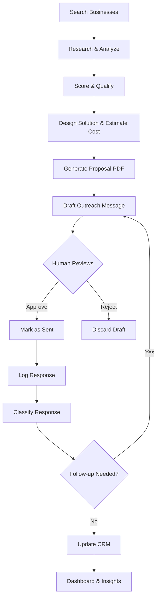
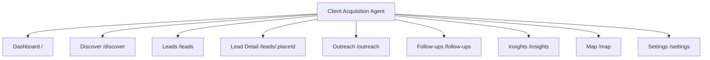

# Frontend Specification — Client Acquisition Agent

> **Version:** 4.0 — Design Polish Pass (Linear / Stripe / Vercel bar)
> **Last Updated:** 2026-09-06
> **Status:** Complete — Ready for Implementation
> **Design Review:** Staff Product Design — aesthetics, motion, hierarchy, onboarding, empty states, accessibility upgraded. Business logic unchanged from v3.0.

---

## Table of Contents

1. [Product Overview](#1-product-overview)
2. [User Types & Roles](#2-user-types--roles)
3. [Feature Inventory](#3-feature-inventory)
4. [Pages & Routes](#4-pages--routes)
5. [Design System](#5-design-system)
6. [Information Architecture](#6-information-architecture)
7. [Dashboards](#7-dashboards)
8. [API Layer](#8-api-layer)
9. [Forms](#9-forms)
10. [Page States](#10-page-states)
11. [Responsive Design](#11-responsive-design)
12. [Accessibility](#12-accessibility)
13. [Performance](#13-performance)
14. [Frontend Architecture](#14-frontend-architecture)
15. [Screen-by-Screen Wireframes](#15-screen-by-screen-wireframes)
16. [Onboarding & First-Run](#16-onboarding--first-run)
17. [Motion & Interaction Spec](#17-motion--interaction-spec)
18. [Empty States & Illustration System](#18-empty-states--illustration-system)

---

## 1. Product Overview

### What It Is

Client Acquisition Agent is an AI-powered lead generation and CRM platform for software consultancy firms targeting local businesses. It discovers local businesses via OpenStreetMap, analyzes their digital presence using web scraping and local LLM inference, scores and qualifies leads, designs software solutions with cost estimates, generates proposal PDFs, drafts personalized outreach messages (email, LinkedIn, WhatsApp), manages a human-in-the-loop approval workflow, tracks CRM pipeline status, classifies responses, schedules follow-ups, and provides funnel analytics.

### Users

The primary user is a **solo consultant or small team** running a software development agency. They use this tool to:

1. Discover untapped local businesses that need software solutions
2. Automatically analyze each business's digital presence
3. Generate tailored proposals with pricing
4. Draft personalized outreach messages
5. Track the entire sales pipeline from discovery to close

### User Roles

| Role | Description | Capabilities |
|------|-------------|--------------|
| **Operator** | The sole human user — a consultant or sales rep | Full access: discovery, analysis, outreach drafting, approval, CRM, dashboard, insights, settings |

> **Note:** This is a single-user application. There is no multi-user authentication, no role-based access control, and no user accounts. The single "Operator" role has full permissions. The frontend should be designed for a single authenticated user who owns the workspace.

### Core Business Workflow



### Value Proposition

- **Zero API costs**: Uses OpenStreetMap (free) + local Ollama LLM (free)
- **Human-in-the-loop safety**: AI drafts, human approves, human sends — never automated outreach
- **End-to-end pipeline**: From discovery to close in one tool
- **Category-specific solutions**: Pre-built templates for restaurant, hotel, school, hospital, real estate
- **Deterministic scoring**: No LLM hallucinated numbers — all scores computed by fixed rules

---

## 2. User Types & Roles

### Operator (Single User)

**Capabilities:**
- Run business discovery searches by category + location
- View research findings for each discovered business
- View lead scores, qualification scores, and priority ratings
- Generate proposals (solution design, tech stack, cost estimate, PDF)
- Draft personalized outreach for email, LinkedIn, or WhatsApp
- Approve or reject individual drafts
- Mark drafts as sent (manual action outside the system)
- Log and classify responses
- View follow-up queue
- View funnel dashboard with KPIs
- Export dashboard data to CSV
- View knowledge base insights by category
- Configure system settings (LLM provider, model selection, thresholds)

**Restrictions:**
- Cannot send messages through the system (only draft + mark as sent)
- Cannot delete leads or proposals
- Cannot modify LLM scoring formulas (hardcoded in backend)

---

## 3. Feature Inventory

### Feature 1: Business Discovery

**Purpose:** Search OpenStreetMap for businesses matching a category in a geographic area.

**Backend Endpoints:**
- `POST /api/discover` — trigger discovery pipeline

**Required Permissions:** Operator

**User Flow:**
1. User enters a category (e.g., "restaurant") and location (e.g., "Dar es Salaam")
2. System geocodes the location via Nominatim
3. System queries Overpass API for matching businesses
4. Each business is saved to the database
5. Results are displayed in a list

**Frontend Requirements:**
- Search form with category dropdown + location autocomplete
- Loading indicator during discovery (can take 30-120 seconds)
- Progress indication per business being processed
- Result list with business cards
- Map view with markers (color-coded by priority)

### Feature 2: Business Research

**Purpose:** Analyze each business's website, social presence, and contact channels.

**Backend Endpoints:**
- Triggered automatically during discovery
- `GET /api/businesses/{place_id}/research` — view research bundle

**User Flow:**
- Automatically runs after discovery
- User can view research details per business

**Frontend Requirements:**
- Research detail panel per business
- Website analysis: has_website, reachable, mobile_friendly, SSL, signals
- Social presence: platforms found vs missing
- Contact channels: email, whatsapp, social links
- Reachability score display

### Feature 3: Problem Detection & Solution Recommendation

**Purpose:** LLM identifies digital gaps and recommends software solutions.

**Backend Endpoints:**
- Triggered automatically during discovery
- `GET /api/businesses/{place_id}/problems` — view detected problems
- `GET /api/businesses/{place_id}/solutions` — view recommended solutions

**User Flow:**
- Automatically runs after research
- User views problems and solutions per lead

**Frontend Requirements:**
- Problems list with reasoning
- Solutions list with potential_value rating (Low/Medium/High)
- Lead score breakdown with reasons

### Feature 4: Lead Scoring & Qualification

**Purpose:** Deterministic scoring of lead quality and priority.

**Backend Endpoints:**
- `GET /api/leads` — list all leads with scores
- `GET /api/leads/{place_id}` — detailed lead info
- `GET /api/leads/{place_id}/qualification` — qualification sub-scores

**User Flow:**
- Automatically computed during discovery
- User views ranked leads

**Frontend Requirements:**
- Lead table sorted by score
- Score breakdown: business_activity, digital_presence, ability_to_pay, solution_need
- Priority badges: High (≥70), Medium (≥40), Low (<40)
- Total score: 0-100

### Feature 5: Solution Design & Cost Estimation

**Purpose:** Design a software solution package and estimate cost/timeline.

**Backend Endpoints:**
- `GET /api/proposals` — list all proposals
- `GET /api/proposals/{id}` — proposal detail
- `GET /api/proposals/{id}/pdf` — download proposal PDF

**Required Permissions:** Operator

**User Flow:**
1. System auto-generates proposals for leads with qualification score ≥ 40
2. User views proposal details
3. User downloads proposal PDF

**Frontend Requirements:**
- Proposal card: package_name, features, tech_stack, cost range, timeline
- PDF download button
- Tech stack display (frontend, backend, database, hosting)
- Cost estimate: $min – $max, weeks_min – weeks_max

### Feature 6: Opportunity Ranking

**Purpose:** Rank all leads by combined need, budget, and reachability scores.

**Backend Endpoints:**
- `POST /api/rankings/refresh` — compute/refresh rankings
- `GET /api/rankings` — list ranked opportunities

**User Flow:**
1. User triggers ranking refresh
2. System computes weighted scores
3. User views ranked list

**Frontend Requirements:**
- Ranked table with final_score, need_score, budget_score, reachability_score
- Visual bar charts for sub-scores
- Sorting by final_score

### Feature 7: Outreach Drafting

**Purpose:** Generate personalized outreach messages for email, LinkedIn, or WhatsApp.

**Backend Endpoints:**
- `POST /api/outreach/draft` — create new draft
- `GET /api/outreach/drafts` — list all drafts
- `GET /api/outreach/drafts/{id}` — draft detail

**Required Permissions:** Operator

**User Flow:**
1. User selects a lead and channel (email/linkedin/whatsapp)
2. System generates personalized draft with hook
3. Draft status: "Pending Approval"

**Frontend Requirements:**
- Channel selector (email, LinkedIn, WhatsApp)
- Draft preview with subject (email only), body, personalization hook
- Status badge: Pending Approval / Approved / Sent / Rejected
- "Draft Follow-up" toggle for follow-up messages

### Feature 8: Human Approval Workflow

**Purpose:** Ensure all outreach is human-approved before sending.

**Backend Endpoints:**
- `POST /api/outreach/drafts/{id}/approve` — approve draft
- `POST /api/outreach/drafts/{id}/reject` — reject draft
- `POST /api/outreach/drafts/{id}/send` — mark as sent

**User Flow:**
1. User reviews pending drafts
2. User approves or rejects each individually
3. After sending externally, user marks as sent
4. CRM is auto-updated to "Contacted" status

**Frontend Requirements:**
- Approve/Reject buttons per draft (only for "Pending Approval" status)
- Mark as Sent button (only for "Approved" status)
- Confirmation dialogs for approve/reject
- Status transition visualizer

### Feature 9: Response Logging & Classification

**Purpose:** Log responses and classify them using LLM.

**Backend Endpoints:**
- `POST /api/outreach/drafts/{id}/response` — log response text

**User Flow:**
1. User pastes the response text from the business
2. System classifies into: Warm Lead / Future Opportunity / Not Interested / Needs More Info / Converted
3. CRM is auto-updated

**Frontend Requirements:**
- Response text input (textarea)
- Classification result display with confidence
- CRM status update notification

### Feature 10: Follow-up Management

**Purpose:** Surface leads due for follow-up after configurable delay.

**Backend Endpoints:**
- `GET /api/follow-ups` — list leads due for follow-up

**User Flow:**
1. System identifies contacted leads with no response after N days
2. User views follow-up queue
3. User drafts follow-up messages

**Frontend Requirements:**
- Follow-up queue table
- Days since last contact
- Quick action: "Draft Follow-up" button per lead
- Empty state when no follow-ups due

### Feature 11: CRM Pipeline

**Purpose:** Track lead status through the sales pipeline.

**Backend Endpoints:**
- `GET /api/crm/leads` — list CRM leads with status
- `GET /api/crm/leads/{place_id}` — CRM lead detail

**User Flow:**
- Auto-updated at each pipeline stage
- User views pipeline status per lead

**Frontend Requirements:**
- Pipeline status badges: New → Qualified → Proposal Sent → Contacted → Warm → Future Opportunity → Not Interested → Won / Lost
- Interest level indicators: Unknown / Low / Medium / High
- Last contact date
- Next follow-up date

### Feature 12: Dashboard & Analytics

**Purpose:** Visualize funnel metrics and lead performance.

**Backend Endpoints:**
- `GET /api/dashboard/funnel` — funnel metrics
- `GET /api/dashboard/leads` — ranked lead detail rows
- `POST /api/dashboard/export` — export to CSV

**User Flow:**
1. User views funnel visualization
2. User views ranked leads table
3. User exports to CSV

**Frontend Requirements:**
- Funnel chart with 10 stages
- KPI cards for key metrics
- Ranked leads table
- CSV export button

### Feature 13: Knowledge Base Insights

**Purpose:** Aggregate conversion stats per category for future recommendations.

**Backend Endpoints:**
- `GET /api/insights` — category conversion stats

**User Flow:**
1. User views per-category statistics
2. System feeds insights back to solution designer when sample size ≥ 5

**Frontend Requirements:**
- Category stats table: total, contacted, replied, converted, conversion_rate, common_package
- Empty state when no data
- Minimum sample size indicator

### Feature 14: Settings

**Purpose:** Configure LLM provider, models, and thresholds.

**Backend Endpoints:**
- `GET /api/settings` — current settings
- `PUT /api/settings` — update settings
- `GET /api/model-status` — Ollama resident models

**User Flow:**
1. User views current configuration
2. User modifies settings
3. User checks model status

**Frontend Requirements:**
- Settings form with all configurable values
- Model status display (resident models, VRAM usage)
- Save button with confirmation

---

## 4. Pages & Routes

### Page 1: Dashboard

**Route:** `/`

**Purpose:** Main landing page showing funnel metrics and top opportunities.

**Target Users:** Operator

**Components Needed:**
- FunnelChart component
- KPICard components (10 metrics)
- RankedLeadsTable component
- ExportButton component

**Data Sources:**
- `GET /api/dashboard/funnel`
- `GET /api/dashboard/leads?limit=50`

**API Endpoints:**
- `GET /api/dashboard/funnel` → `FunnelMetrics`
- `GET /api/dashboard/leads?limit=50` → `DashboardLeadRow[]`

**Empty States:**
- "No data yet. Start by discovering businesses."
- Show empty funnel visualization with zeros
- CTA button: "Discover Businesses"

**Loading States:**
- Skeleton cards for KPIs
- Skeleton table rows for leads
- Spinner on export button

**Error States:**
- "Failed to load dashboard data. Retry?"
- Toast notification with error details

**Success States:**
- KPI cards animate to values
- Table populated with data
- Export completes with "Exported to {filename}" toast

**Permissions:** Operator (full access)

**Responsive Behavior:**
- Desktop: 4-column KPI grid, full table
- Tablet: 2-column KPI grid, scrollable table
- Mobile: 1-column KPI grid, card-based layout

**Accessibility Notes:**
- Funnel chart has screen reader alternative text
- Table is keyboard navigable
- KPI values announced to screen readers

---

### Page 2: Discover

**Route:** `/discover`

**Purpose:** Search for businesses and run the discovery pipeline.

**Target Users:** Operator

**Components Needed:**
- SearchForm component (category + location)
- CategoryDropdown component
- LocationInput component
- LimitInput component
- GenerateProposalsToggle component
- MinQualificationInput component
- ProgressIndicator component
- BusinessResultsList component
- BusinessCard component
- LeadsMap component (Leaflet)

**Data Sources:**
- `POST /api/discover` (triggers pipeline)
- `GET /api/categories` (for dropdown)

**API Endpoints:**
- `POST /api/discover` → `{ query?, category, location, limit, generate_proposals, min_qualification }` → `{ reports, map_path, proposals_count }`
- `GET /api/categories` → `string[]`

**Empty States:**
- "Select a category and location to discover businesses"
- Category list: 26 supported categories
- Map placeholder: "Results will appear here"

**Loading States:**
- Progress bar: "Discovering businesses..."
- Per-business status: "Researching {name}..."
- Map loading overlay

**Error States:**
- "Could not geocode location. Check the spelling."
- "Overpass API unavailable. Try again later."
- "Discovery failed for {name}. Continuing with others..."

**Success States:**
- Results count: "Found {n} businesses"
- Map populated with markers
- Lead reports listed
- Proposals generated (if enabled)

**Permissions:** Operator

**Responsive Behavior:**
- Desktop: Side-by-side form + map
- Tablet: Stacked form + map
- Mobile: Full-width form, map below results

**Accessibility Notes:**
- Form labels for all inputs
- Category dropdown keyboard searchable
- Map has text alternative
- Progress announced to screen readers

---

### Page 3: Leads

**Route:** `/leads`

**Purpose:** View all discovered leads with scores and details.

**Target Users:** Operator

**Components Needed:**
- LeadsTable component
- LeadFilters component (priority, category, score range)
- LeadRow component
- PriorityBadge component
- ScoreBar component
- SearchInput component

**Data Sources:**
- `GET /api/leads?limit=50&priority=&category=&min_score=&max_score=`

**API Endpoints:**
- `GET /api/leads` → `LeadRow[]`
  - `name`, `category`, `lead_score`, `priority`, `problems`, `solutions`, `potential_value`

**Empty States:**
- "No leads found. Run a discovery first."
- CTA: "Discover Businesses"

**Loading States:**
- Skeleton table rows
- Spinner on filters

**Error States:**
- "Failed to load leads. Retry?"

**Success States:**
- Table sorted by lead_score DESC
- Priority badges colored: High=red, Medium=orange, Low=gray
- Click row → navigate to lead detail

**Permissions:** Operator

**Responsive Behavior:**
- Desktop: Full table with all columns
- Tablet: Condensed columns, horizontal scroll
- Mobile: Card-based layout per lead

**Accessibility Notes:**
- Table headers sortable (click)
- Keyboard navigation between rows
- Screen reader announces score and priority

---

### Page 4: Lead Detail

**Route:** `/leads/:placeId`

**Purpose:** Single-pane-of-glass for one business — decide in <30s whether to pursue, then act without leaving.

**Layout (Linear issue-view inspired — replaces stacked panels):**
- Sticky header (64px, blur): Back + name (16px semibold) + category pill + PriorityDot + score ring (36px) left; right: `Draft outreach` primary + `⋯` menu (Copy link, Copy address, View on OSM, Mark Won/Lost). Sub-row: address · phone (click-to-call `tel:`) · website (external icon) · `place_id` mono copyable.
- Body: 2-column on desktop (main 1fr + right rail 320px sticky). Tabs in main: `Overview | Research | Proposal | Outreach (count) | Activity`. Deep-linkable (`?tab=outreach&draft=7`), keyboard `1-5` switches tabs.
- Right rail (always visible desktop, accordion mobile): Qualification donut + 4 sub-scores with reason tooltips; CRM card (pipeline stepper New→Won, interest segmented control, last/next dates); Reachability card (channels as icons + score + `Best channel: email` recommendation).
- Activity tab: chronological timeline (discovered → scored → proposal → draft → sent → response) — replaces scattered timestamps, builds trust in AI pipeline.

**Channel-accurate draft preview (new):**
- Email: subject line (15px semibold) + `To: info@…` + body in readable 14px/22px + hook highlighted (amber underline + `Personalization` label + tooltip explaining source signal).
- WhatsApp: phone-frame bubble (green-tinted bg, tail, 13px) + character/segment count + `Open in WhatsApp` (prefilled `wa.me` link, manual send only).
- LinkedIn: 300-char connection-note style + warning if >300 chars (`LinkedIn invites truncate at 300 — 42 over`) + `Copy for LinkedIn` button.
- All: `Copy body (x)` + `Copy + open channel` + provenance chip (`✦ AI · qwen2.5:7b · Sep 1`) + readability hint (`Grade 8 · 142 words · ~45s read`).

**Target Users:** Operator

**Components Needed:**
- LeadHeader component (name, category, address, phone, website)
- ResearchPanel component
  - WebsiteFindings sub-component
  - SocialFindings sub-component
  - ReachabilityInfo sub-component
- ProblemsList component
- SolutionsList component
- QualificationPanel component
  - ScoreBreakdown sub-component (4 sub-scores)
  - PriorityBadge
- ProposalPanel component (if exists)
  - ProposalCard with features, tech stack, cost, timeline
  - PDF download button
- OutreachPanel component
  - DraftList sub-component
  - DraftCard sub-component
  - DraftControls (approve/reject/mark-sent)
- ResponsePanel component
  - ResponseForm sub-component
  - ClassificationResult sub-component
- CRMPanel component
  - PipelineStatus sub-component
  - InterestLevel sub-component
  - FollowUpDate sub-component

**Data Sources:**
- `GET /api/businesses/{placeId}`
- `GET /api/businesses/{placeId}/research`
- `GET /api/leads/{placeId}/qualification`
- `GET /api/proposals?place_id={placeId}`
- `GET /api/outreach/drafts?place_id={placeId}`
- `GET /api/crm/leads/{placeId}`
- `GET /api/responses?place_id={placeId}`

**API Endpoints:**
- `GET /api/businesses/{placeId}` → `Business`
- `GET /api/leads/{placeId}/qualification` → `QualificationScore`
- `GET /api/proposals?place_id={placeId}` → `Proposal[]`
- `GET /api/outreach/drafts?place_id={placeId}` → `OutreachDraft[]`
- `GET /api/crm/leads/{placeId}` → `CRMLead`
- `GET /api/responses?place_id={placeId}` → `ResponseRecord[]`

**Empty States:**
- "No proposal generated for this lead" + "Generate Proposal" button
- "No outreach drafts" + "Draft Outreach" button
- "No responses logged"
- "CRM status: New"

**Loading States:**
- Skeleton panels
- Spinner per section

**Error States:**
- "Lead not found" with back button
- "Failed to load lead details"

**Success States:**
- All panels populated
- Toast: "Draft created" / "Draft approved" / "Response logged"

**Permissions:** Operator

**Responsive Behavior:**
- Desktop: Multi-column layout with sidebar
- Tablet: Two-column layout
- Mobile: Stacked sections, accordion-style

**Accessibility Notes:**
- Section headings for navigation
- Keyboard shortcuts for approve/reject
- Focus management after actions

---

### Page 5: Outreach

**Route:** `/outreach`

**Purpose:** Manage all outreach drafts across all leads.

**Target Users:** Operator

**Components Needed:**
- DraftsTable component
- DraftFilters component (status, channel)
- DraftRow component
- StatusBadge component
- ChannelIcon component
- BulkActions component (not applicable — individual approval only)
- CreateDraftButton component

**Data Sources:**
- `GET /api/outreach/drafts?status=&channel=&limit=50`

**API Endpoints:**
- `GET /api/outreach/drafts` → `OutreachDraft[]`
  - `id`, `business_name`, `channel`, `status`, `created_at`, `approved_at`, `sent_at`

**Empty States:**
- "No drafts yet. Select a lead to start drafting."
- CTA: "Go to Leads"

**Loading States:**
- Skeleton table

**Error States:**
- "Failed to load drafts"

**Success States:**
- Table sorted by id DESC
- Status badges: Pending Approval (yellow), Approved (green), Sent (blue), Rejected (red)
- Click row → navigate to lead detail with draft panel open

**Permissions:** Operator

**Responsive Behavior:**
- Desktop: Full table
- Tablet: Condensed table
- Mobile: Card layout with swipe actions

**Accessibility Notes:**
- Status announced with aria-live
- Keyboard shortcuts for approve/reject

---

### Page 6: Follow-ups

**Route:** `/follow-ups`

**Purpose:** View leads due for follow-up and draft follow-up messages.

**Target Users:** Operator

**Components Needed:**
- FollowUpQueue component
- FollowUpRow component
- DaysSinceContact component
- DraftFollowUpButton component
- EmptyQueueMessage component

**Data Sources:**
- `GET /api/follow-ups`

**API Endpoints:**
- `GET /api/follow-ups` → `FollowUpLead[]`
  - `place_id`, `name`, `category`, `last_contact_date`, `next_follow_up_date`

**Empty States:**
- "No leads due for follow-up. All caught up!"

**Loading States:**
- Skeleton rows

**Error States:**
- "Failed to load follow-up queue"

**Success States:**
- Queue sorted by last_contact_date ASC (oldest first)
- "Draft Follow-up" button per lead

**Permissions:** Operator

**Responsive Behavior:**
- Desktop: Table layout
- Mobile: Card layout

**Accessibility Notes:**
- "Draft Follow-up" button has descriptive label
- Date announced in human-readable format

---

### Page 7: Insights

**Route:** `/insights`

**Purpose:** View knowledge base — conversion stats by category.

**Target Users:** Operator

**Components Needed:**
- InsightsTable component
- CategoryStatRow component
- ConversionRateBar component
- EmptyInsightsMessage component
- SampleSizeIndicator component

**Data Sources:**
- `GET /api/insights`

**API Endpoints:**
- `GET /api/insights` → `CategoryInsight[]`
  - `category`, `total`, `contacted`, `replied`, `converted`, `conversion_rate`, `common_package`

**Empty States:**
- "No outreach data yet. Run discovery + outreach first."
- Show minimum sample size requirement: "Insights appear after 5+ contacted leads per category"

**Loading States:**
- Skeleton table

**Error States:**
- "Failed to load insights"

**Success States:**
- Table sorted by category ASC
- Conversion rate as percentage with bar
- Common package displayed

**Permissions:** Operator

**Responsive Behavior:**
- Desktop: Full table
- Mobile: Card layout

**Accessibility Notes:**
- Conversion rate announced as percentage
- Table sortable by column

---

### Page 8: Map

**Route:** `/map`

**Purpose:** Interactive map view of all discovered leads.

**Target Users:** Operator

**Components Needed:**
- LeafletMap component
- MapMarker component (color-coded by priority)
- MarkerPopup component (business details)
- MapControls component (zoom, reset view)
- MapLegend component

**Data Sources:**
- `GET /api/leads?limit=200` (for marker positions)

**API Endpoints:**
- `GET /api/leads` → `LeadRow[]` with `latitude`, `longitude`, `priority`

**Empty States:**
- "No businesses discovered yet. Run a search first."

**Loading States:**
- Map skeleton with placeholder markers
- "Loading map..."

**Error States:**
- "Failed to load map data"

**Success States:**
- Map centered on discovered area
- Markers: Red=High, Orange=Medium, Gray=Low priority
- Click marker → popup with business name, score, priority
- Click popup → navigate to lead detail

**Permissions:** Operator

**Responsive Behavior:**
- Desktop: Full-screen map with sidebar
- Tablet: Full-screen map with overlay controls
- Mobile: Map takes full viewport, controls as bottom sheet

**Accessibility Notes:**
- Map has text alternative listing businesses
- Keyboard navigation for markers
- High contrast markers

---

### Page 9: Settings

**Route:** `/settings`

**Purpose:** Configure system settings.

**Target Users:** Operator

**Components Needed:**
- SettingsForm component
- LLMProviderSelect component
- OllamaSettings component
- GroqSettings component
- ModelStatusPanel component
- ThresholdSettings component
- SaveButton component

**Data Sources:**
- `GET /api/settings`
- `GET /api/model-status`

**API Endpoints:**
- `GET /api/settings` → `Settings`
- `PUT /api/settings` → `Settings` (updated)
- `GET /api/model-status` → `ModelStatus[]`
  - `name`, `size`, `vram`, `expires_at`

**Empty States:**
- "No models loaded in memory"

**Loading States:**
- Spinner on model status
- Saving indicator on form

**Error States:**
- "Could not reach Ollama at {host}"
- "Failed to save settings"

**Success States:**
- "Settings saved" toast
- Model status refreshed

**Permissions:** Operator

**Responsive Behavior:**
- Desktop: Two-column form
- Mobile: Single-column form

**Accessibility Notes:**
- Form labels for all inputs
- Error messages linked to inputs
- Success announced to screen readers

---

## 5. Design System

### Design Philosophy

**Visual Style:** Neutral-first, Linear / Vercel-inspired. Monochrome slate surfaces carry structure; indigo is reserved strictly for primary actions, active nav, and focus. No gradients on surfaces, no colored card backgrounds, no emoji in UI. Depth comes from 1px borders + subtle shadows + spacing, not color noise. Stripe-inspired data clarity: tabular numerals, right-aligned metrics, honest zeros.

**Principles (upgraded):**
1. **Speed feels like quality** — every interaction acknowledges in <100ms (optimistic), then confirms.
2. **Neutral canvas, surgical color** — color always means something (priority, status, delta). Never decorative.
3. **Progressive disclosure** — hero metric → supporting detail → raw data. 4 hero KPIs max per viewport; rest behind tabs/expanders.
4. **Human-in-the-loop clarity** — every AI artifact shows provenance chip: `AI draft · qwen2.5:7b · Sep 1 12:00` + what human must do next.
5. **Keyboard is a first-class citizen** — ⌘K everywhere, j/k navigation, single-key triage.
6. **Calm empty, honest loading, recoverable error** — no dead ends; every state has a next action.

**Surface Hierarchy (new — must implement):**
1. `bg-base` — app canvas
2. `bg-subtle` — sidebar, table header, inset panels
3. `bg-surface` — cards, modals, popovers (white / dark-elevated)
4. `bg-inset` — code, score breakdown wells, log areas
5. Borders: `border-subtle` (default), `border-strong` (hover/focus), `border-selected` (indigo, 1.5px for selected card/row)

**Density:** Default `comfortable` (row height 48px, card padding 20px). `compact` toggle on Leads/Outreach tables (row height 36px) persisted to localStorage. Touch targets never <24px even in compact; primary actions never <36px high.

**Iconography (new):** Lucide only, 16px default, stroke 1.75px, `aria-hidden` unless standalone (then `aria-label`). Never emoji as icon. Status always icon + text + color (never color alone).

**Hierarchy:**
1. Page title (20px semibold, tracking -0.01em) + contextual subtitle (13px muted) + primary action right-aligned
2. `Next Best Action` strip (only when actionable — e.g. "5 drafts await review")
3. Hero content (funnel / queue / detail header)
4. Supporting tables/cards
5. Secondary metadata (timestamps, model provenance, `place_id` in mono 12px muted, copyable)

**Spacing Scale (8px base):**
```
--space-1: 4px
--space-2: 8px
--space-3: 12px
--space-4: 16px
--space-5: 20px
--space-6: 24px
--space-8: 32px
--space-10: 40px
--space-12: 48px
--space-16: 64px
```

### Color System

> **Rule:** Light and dark themes are required. Theme toggle in header (Sun/Moon, persists to localStorage, respects `prefers-color-scheme` on first run). All color pairs below are WCAG AA-verified. Status hues are identical in meaning across themes; only luminance shifts.

**Primary Colors (action-only — do not use for large surfaces):**
```
--color-primary-50:  #EEF2FF
--color-primary-100: #E0E7FF
--color-primary-200: #C7D2FE
--color-primary-300: #A5B4FC
--color-primary-400: #818CF8
--color-primary-500: #6366F1  (primary)
--color-primary-600: #4F46E5
--color-primary-700: #4338CA
--color-primary-800: #3730A3
--color-primary-900: #312E81
```

**Secondary Colors (Slate):**
```
--color-secondary-50:  #F8FAFC
--color-secondary-100: #F1F5F9
--color-secondary-200: #E2E8F0
--color-secondary-300: #CBD5E1
--color-secondary-400: #94A3B8
--color-secondary-500: #64748B
--color-secondary-600: #475569
--color-secondary-700: #334155
--color-secondary-800: #1E293B
--color-secondary-900: #0F172A
```

**Accent Colors (Amber):**
```
--color-accent-400: #FBBF24
--color-accent-500: #F59E0B
--color-accent-600: #D97706
```

**Success Colors:**
```
--color-success-50:  #F0FDF4
--color-success-100: #DCFCE7
--color-success-500: #22C55E
--color-success-600: #16A34A
--color-success-700: #15803D
```

**Warning Colors:**
```
--color-warning-50:  #FFFBEB
--color-warning-100: #FEF3C7
--color-warning-500: #F59E0B
--color-warning-600: #D97706
--color-warning-700: #B45309
```

**Danger Colors:**
```
--color-danger-50:  #FEF2F2
--color-danger-100: #FEE2E2
--color-danger-500: #EF4444
--color-danger-600: #DC2626
--color-danger-700: #B91C1C
```

**Neutral Palette (Light — default):**
```
--color-bg:         #FFFFFF
--color-bg-subtle:  #F8FAFC
--color-bg-muted:   #F1F5F9
--color-bg-inset:   #F1F5F9  (wells, code, score breakdown)
--color-surface:    #FFFFFF  (cards, modals)
--color-border:     #E2E8F0  (subtle — default hairline)
--color-border-strong: #CBD5E1 (hover, inputs)
--color-border-selected: #6366F1 (selected card, active filter pill)
--color-text:       #0F172A
--color-text-secondary: #475569
--color-text-muted: #94A3B8
```

**Neutral Palette (Dark — required):**
```
--color-bg:         #09090B  (zinc-950)
--color-bg-subtle:  #111113  (sidebar, header)
--color-bg-muted:   #1A1B1E
--color-bg-inset:   #131316
--color-surface:    #17171A  (cards, modals, popovers)
--color-border:     #232428  (subtle hairline on dark)
--color-border-strong: #34353A
--color-border-selected: #818CF8
--color-text:       #FAFAFA
--color-text-secondary: #A1A1AA
--color-text-muted: #63636B
```

**Semantic Usage Rules (new — enforce in review):**
- Priority High = red dot + `High` text + score. Never red background wash. Map marker: filled red-500 with white ring + dark stroke for contrast.
- Priority Medium = amber dot. Low = zinc-400 dot.
- Draft status: Pending = amber pill + pulsing dot (motion respects reduced-motion); Approved = emerald pill; Sent = indigo/blue pill; Rejected = zinc pill (not red — rejection is neutral, not error).
- Response classification: Warm/Converted = emerald; Needs More Info = blue; Future = amber; Not Interested = zinc.
- Deltas: positive = emerald-600 with `▲`, negative = red-600 with `▼`, always with icon + text.
- Focus ring is always visible indigo, never removed.

### Typography System

**Font Family:** `Inter` (UI) with `font-feature-settings: "cv11", "ss01", "tnum"` for tables/scores. Headings: `tracking: -0.02em` (20-30px), `-0.01em` (14-18px). Body never tighter than `-0.005em`. Mono: `JetBrains Mono` for `place_id`, coordinates, model names, timestamps in tables.

```css
--font-sans: 'Inter', -apple-system, BlinkMacSystemFont, 'Segoe UI', sans-serif;
--font-mono: 'JetBrains Mono', 'Fira Code', monospace;
```

**Font Sizes:**
```
--text-xs:   12px / 16px
--text-sm:   14px / 20px
--text-base: 16px / 24px
--text-lg:   18px / 28px
--text-xl:   20px / 28px
--text-2xl:  24px / 32px
--text-3xl:  30px / 36px
--text-4xl:  36px / 40px
```

**Font Weights:**
```
--font-normal:   400
--font-medium:   500
--font-semibold: 600
--font-bold:     700
```

### Design Tokens

**Border Radius:**
```
--radius-sm:   4px
--radius-md:   6px
--radius-lg:   8px
--radius-xl:   12px
--radius-2xl:  16px
--radius-full: 9999px
```

**Shadows (softer, Linear-style — 1px ring + ambient):**
```
--shadow-xs:  0 1px 2px rgba(16,24,40,0.05)
--shadow-sm:  0 1px 2px rgba(16,24,40,0.06), 0 1px 3px rgba(16,24,40,0.08)
--shadow-md:  0 2px 4px rgba(16,24,40,0.06), 0 4px 12px rgba(16,24,40,0.08)
--shadow-lg:  0 8px 24px rgba(16,24,40,0.10), 0 2px 6px rgba(16,24,40,0.06)
--shadow-xl:  0 16px 48px rgba(16,24,40,0.14), 0 4px 12px rgba(16,24,40,0.08)
--ring: 0 0 0 1px var(--color-border)  (applied to all cards by default)
--ring-focus: 0 0 0 2px var(--color-bg), 0 0 0 4px var(--color-primary-500)
--dark-shadow-sm: 0 1px 2px rgba(0,0,0,0.4)
--dark-shadow-lg: 0 8px 32px rgba(0,0,0,0.5)
```

**Motion Tokens (new — see §17 for full spec, summary here):**
```
--duration-instant: 80ms   (press, toggle knob)
--duration-fast:    120ms  (hover, fade)
--duration-normal:  180ms  (expand, toast slide)
--duration-slow:    280ms  (modal spring, page fade)
--duration-slower:  480ms  (funnel stagger, count-up, skeleton shimmer loop 1.6s)
--ease-default:    cubic-bezier(0.32, 0.72, 0, 1)  (Vercel/Linear-out — no linear, no ease-in)
--ease-spring:     cubic-bezier(0.16, 1, 0.3, 1)   (modals, popovers, markers)
--ease-out:        cubic-bezier(0, 0, 0.2, 1)
--motion-reduced:  all durations → 0ms when (prefers-reduced-motion: reduce)
```
**Transitions:**
```
transition: all var(--duration-normal) var(--ease-default);
Buttons: transform + background-color + box-shadow only (never `all` on tables).
Respect prefers-reduced-motion: disable shimmer, count-up (jump to final), marker pop, funnel stagger.
```

### Component Library

#### Buttons

**Variants:**
- `primary` — indigo-600 bg, white text, `shadow-xs` + inner highlight `inset 0 1px 0 rgba(255,255,255,0.12)`. Hover: indigo-500 + translateY(-0.5px). Active: scale 0.97, 80ms. Dark: indigo-500 bg.
- `secondary` — `bg-surface`, 1px `border-strong`, text-secondary. Hover: bg-subtle + border-strong. Active: scale 0.98.
- `danger` — red-600 bg, white text. Always requires confirmation modal (destructive pattern).
- `ghost` — transparent, text-secondary, hover bg-muted. For icon buttons: 32px square, radius-md, tooltip on hover (400ms delay).
- `link` — no background, primary-600 text, underline offset 3px on hover. Min touch target preserved via padding.

**Sizes:**
- `sm` — height 32px, padding 0 12px, text-sm (13px medium)
- `md` — height 36px, padding 0 16px, text-sm
- `lg` — height 40px, padding 0 20px, text-base (landing/empty-state CTAs only)

**States:**
- Default / Hover (lift + shadow) / Active (scale 0.97-0.98, 80ms) / Disabled (opacity 0.5, `not-allowed`, tooltip explains why) / Loading (spinner 14px replaces icon, label stays to prevent layout shift, button disabled, `aria-busy=true`)
- Focus-visible: 2px indigo ring offset 2px — never hidden.

**Behavior:**
- Optimistic: Approve/Reject/Mark-sent update UI instantly (<100ms), toast confirms, rollback + error toast on failure.
- Loading state prevents double-click (idempotency key on draft mutations).
- Danger variant requires confirmation dialog with typed consequence + Undo toast (8s) where reversible (Reject → Undo).
- Icon + label buttons: icon 16px left, 6px gap. Icon-only buttons must have `aria-label` + tooltip.
- Primary action per viewport: exactly one `primary` button above the fold (e.g. Discover page: `Discover`; Outreach queue: `Approve` in triage mode).

#### Inputs

**Variants:**
- `text` — 36px high, radius-lg (8px), bg-surface, 1px border-strong. Placeholder text-muted, never as label.
- `textarea` — min 96px, auto-grow to 240px, mono for response paste, character count bottom-right (e.g. `142 / min 10`).
- `select` — custom popover (not native), ⌘-filterable, checkmark on selected, `aria-expanded` + listbox roles.
- `search` — text with search icon left, `⌘K` kbd hint right, clear (×) appears when value present, debounced 250ms.
- `number` — numeric input with stepper on hover, tabular numerals, clamps on blur with inline hint (e.g. `1–50`).

**States:**
- Default — border-strong
- Hover — border darkens
- Focus — 1.5px primary border + 3px primary-100 ring (dark: primary-500/20), label floats/moves to primary-600, 120ms
- Error — red-500 border + red-500/10 ring, error message below with `⊘` icon, `aria-invalid=true` + `aria-describedby`
- Disabled — bg-muted, opacity 0.6, `not-allowed`
- Loading — spinner 14px inside right slot

**Validation & Microcopy (Stripe bar):**
- Validate on blur (soft) + on submit (hard). Never validate aggressively on first keystroke.
- Error copy is specific + recoverable: `Limit must be 1–50. You entered 120.` + inline fix hint.
- Success: green check appears in-field for 1.2s on valid blur (settings, discovery).
- Labels always visible above input (13px medium). Help text 12px muted below. Required marked with red `*` + `aria-required`.

#### Tables

**Structure:**
```
<table> — header sticky (bg-subtle/80 + backdrop-blur 8px + border-b)
  <thead>
    <th> — 12px uppercase tracking-wide muted, sortable with chevron (↕ → ↑/↓), aria-sort, tooltip shows sort logic
  <tbody>
    <tr> — 48px comfortable / 36px compact, hover:bg-subtle, selected: left 2px indigo inset + bg-primary-50/50 (dark: primary-500/10), focus-visible ring-inset
      <td> — 14px, metrics tabular-nums right-aligned, truncation with tooltip (max 2 lines, expand on click)
```

**Features (Linear-grade density + Stripe clarity):**
- Sortable columns (click header, `aria-sort`; shift-click multi-sort on Leads). Sort persists in URL query (`?sort=lead_score&order=desc`).
- Row click navigates; nested buttons stopPropagation. Checkbox column only where bulk is allowed (never on Outreach — explicitly single-approve for safety).
- Sticky header + sticky first column on horizontal scroll (tablet). Column visibility menu (eye icon) persisted.
- Saved views pill bar above table: `All · High priority · Needs proposal · Contacted` — one-click filters, shareable via URL.
- Row hover reveals quick actions (View, Draft, Approve) with 120ms fade — reduces travel distance.
- Pagination footer: `Showing 1–50 of 142` + prev/next + page-size select (25/50/100). Infinite scroll on mobile cards only.
- Skeleton: shimmer rows matching column widths (not generic gray blocks), 1.6s loop, disabled under reduced-motion (static pulse).
- Empty-filtered vs empty-data distinguished (see §18).

#### Cards

**Variants:**
- `default` — bg-surface, 1px border-subtle + ring, shadow-xs, radius-xl (12px)
- `elevated` — bg-surface, shadow-md, no border (modals, popovers, marker popups only)
- `interactive` — hover: translateY(-1px) + shadow-md + border-strong, 180ms ease-default; active scale 0.99; focus-visible ring. Cursor-pointer + `role=link/button` as appropriate.

**Structure:**
```
<div class="card">
  <div class="card-header"> — 14px semibold title + muted 12px subtitle left; icon actions right (ghost icon buttons, tooltip)
  <div class="card-body"> — 16px/20px padding, 14px body text, 20px line-height rhythm
  <div class="card-footer"> — 12px muted metadata + provenance chip right (e.g. `AI · qwen2.5:7b`)
```
- BusinessCard (Discover/Leads): top row name + PriorityDot + score ring (SVG, animated stroke-dashoffset 480ms); second row category pill + address truncated; third row top-2 problems as muted bullets; footer: `View →` + quick `Draft` ghost button on hover.
- Score ring: 36px, track border-subtle, fill indigo (High: red-500? No — score fill always indigo, priority carries hue to avoid double-encoding).

#### Modals

**Structure:**
```
<div class="modal-overlay"> — bg-black/50 (dark: black/70) + backdrop-blur 4px, fade 120ms
  <div class="modal"> — centered, max-w-md (448px), radius-2xl (16px), shadow-xl, bg-surface, spring-in 280ms (scale 0.96→1 + translateY 8px→0, ease-spring)
    <div class="modal-header"> — 16px semibold title + 13px muted description + close (×) ghost button top-right
    <div class="modal-body"> — 14px content, 20px rhythm
    <div class="modal-footer"> — right-aligned: Cancel (secondary) + Confirm (primary/danger), 12px hint left (e.g. `This only rejects the draft — lead is kept.`)
```

**Behavior:**
- Escape closes (unless destructive confirm in-flight). Click outside closes only non-destructive modals.
- Focus trapped, initial focus on least-destructive action (Cancel) except triage-approve where Approve is autofocused for speed + `↵` hint.
- Returns focus to trigger on close. `role="dialog" aria-modal="true" aria-labelledby`.
- Approve/Reject confirmations show draft excerpt (hook + first 140 chars) + channel icon + consequence line (`CRM → Contacted on send`) — no blind confirms.
- Mobile: bottom sheet (radius top 16px, drag handle, swipe-down to dismiss non-destructive).

#### Toasts (Sonner — bottom-right desktop, top-center mobile)

**Variants:**
- `success` — surface bg, emerald dot + check icon, 1px border
- `error` — surface bg, red dot + alert icon, `Retry` action button inline
- `warning` — amber dot
- `info` — indigo dot
- All: 13px medium title + 12px muted description, radius-xl, shadow-lg, slide+fade 180ms, swipe-to-dismiss.

**Behavior:**
- Auto-dismiss 4s (success/info), 6s (warning), persistent until dismissed (error). Pause on hover/focus.
- Newest stacks on top, max 3 visible, rest queued with count (`+2 more`).
- Every toast that follows a reversible action includes `Undo` (Reject, filter clear). Optimistic actions toast with `View →` deep link (e.g. `Draft #7 created → View`).
- `role="status" aria-live="polite"`; errors `role="alert"`.

#### Badges

**Anatomy (always dot + label, never color alone):**
- `High` — red-600 dot (8px) + red-700 text on red-50 pill (dark: red-400 dot on red-500/10) + `aria-label="High priority"`
- `Medium` — amber dot + amber text
- `Low` — zinc dot + zinc text
- `Pending Approval` — amber pill + pulsing dot (2s, disabled reduced-motion) + clock icon
- `Approved` — emerald pill + check; `Sent` — blue/indigo pill + send icon; `Rejected` — zinc pill + minus icon
- `AI draft` provenance chip — zinc-100, mono 11px, `✦ AI · qwen2.5:7b` (✦ is decorative, aria-hidden)
- Size sm (12px, h-22px, padding 6px) for tables; md (12px medium, h-24px) for headers. Uppercase never used (sentence case only).

#### Avatars

**Variants:**
- Initials — colored background with initials
- Icon — placeholder icon

**Sizes:** sm (24px), md (32px), lg (40px)

#### Pagination

**Structure:**
```
<div class="pagination">
  <button>← Previous</button>
  <span>Page {current} of {total}</span>
  <button>Next →</button>
</div>
```

**Behavior:**
- Disabled at first/last page
- Shows current page and total pages

#### Search Bars

**Structure:**
```
<div class="search-bar">
  <SearchIcon />
  <input type="search" placeholder="Search..." />
  <kbd>⌘K</kbd> (keyboard shortcut hint)
</div>
```

**Behavior:**
- Debounced input (300ms)
- Clear button appears when input has value
- Keyboard shortcut: ⌘K focuses search

#### Filters

**Structure:**
```
<div class="filters">
  <Select label="Priority" options={[High, Medium, Low]} />
  <Select label="Category" options={[...categories]} />
  <RangeSlider label="Score" min={0} max={100} />
  <Button variant="ghost" onClick={clearFilters}>Clear</Button>
</div>
```

**Behavior:**
- Applied immediately (no submit button)
- Clear button resets all filters
- Active filter count shown

#### Date Pickers

**Structure:**
```
<div class="date-picker">
  <input type="date" />
  <CalendarIcon />
</div>
```

**Behavior:**
- Native HTML date input (no library dependency)
- Format: YYYY-MM-DD

#### File Upload Components

**Not applicable** — this application does not handle file uploads from the user. PDFs are generated server-side and downloaded.

#### Notification Components

**Structure:**
```
<div class="notification">
  <BellIcon />
  <span class="notification-count">3</span>
</div>
```

**Behavior:**
- Shows count of pending approvals
- Click opens notification panel
- Badge pulses when new items arrive

#### Navigation Components

**Sidebar (desktop, 240px expanded / 64px icon-only on tablet):**
```
<nav class="sidebar" aria-label="Main">
  <Logo />  (16px wordmark `Acq Agent` + indigo mark; click → /)
  <OnboardingChecklist /> (progress ring, collapses when complete — see §16)
  <NavSection label="Workspace">
    <NavItem icon={LayoutDashboard} label="Dashboard" href="/" kbd="g d" badge={null} />
    <NavItem icon={Search} label="Discover" href="/discover" kbd="g i" />
    <NavItem icon={Users} label="Leads" href="/leads" kbd="g l" badge={highPriorityCount} />
    <NavItem icon={Map} label="Map" href="/map" kbd="g m" />
  <NavSection label="Pipeline">
    <NavItem icon={Mail} label="Outreach" href="/outreach" kbd="g o" badge={pendingCount amber dot} />
    <NavItem icon={Clock} label="Follow-ups" href="/follow-ups" kbd="g f" badge={dueCount} />
    <NavItem icon={BarChart3} label="Insights" href="/insights" kbd="g s" />
  <NavItem icon={Settings} label="Settings" href="/settings" /> (bottom-pinned, + Ollama status dot: green reachable / red unreachable)
</nav>
```
- Active: bg-muted + 2px indigo left inset + semibold text + icon indigo. Hover: bg-subtle 120ms. Focus-visible ring.
- Badges: 20px pill, tabular-nums, amber for pending, zinc for counts. Never red unless blocking error.
- Collapsible sections persist. Tooltips on icon-only mode (400ms delay, 12px).

**Header (sticky, 56px, bg-base/80 + blur 12px + border-b):**
```
<header>
  <HamburgerButton /> (mobile only, 40px target)
  <CommandPaletteTrigger /> (`Search or command…` button, ⌘K kbd, click → palette)
  <ThemeToggle /> <NotificationBell badge /> <HealthDot (Ollama)/> <UserAvatar `OP` />
</header>
```
- Global search is command palette, not a plain input (see below). Bell opens triage panel: pending approvals + due follow-ups + failed jobs, each row deep-links.

**Command Palette (⌘K / Ctrl+K — required, Linear-grade):**
- Trigger from header, `g`-then-key nav, or `/` on list pages. Opens spring modal (top-20%, max-w-lg).
- Sources: pages, leads (fuzzy by name/category/address, shows score + priority dot), drafts (by id/business), actions (`Approve draft #7`, `Draft follow-up for…`, `Refresh rankings`, `Export CSV`, `Toggle theme`, `Go to settings`).
- Keyboard: ↑↓ navigate, ↵ run, esc close, `⌘↵` open in new context (lead detail). Recent items pinned. `aria-combobox` + listbox.
- Empty query shows `Recents` + `Suggested: Review 5 pending drafts`.

**Keyboard Shortcuts (global — `?` opens cheat sheet):**
- `⌘K` palette, `g d/i/l/o/f/s/m` go-to, `j/k` next/prev row, `↵` open, `a` approve, `r` reject, `e` mark sent, `c` create draft, `x` copy draft body, `t` theme, `?` help. Triage mode (`o` then `t`): full-screen queue with single-key approve/reject + progress `3/12 reviewed`.

**Header:**

```
<header class="header">
  <HamburgerButton /> (mobile only)
  <SearchBar /> (→ CommandPaletteTrigger, see above)
  <NotificationBell />
  <UserAvatar />
</header>
```

#### Dashboard Widgets

**Next Best Action strip (required on Dashboard, Outreach, Follow-ups):**
```
<div class="nba"> <Sparkles 14px indigo /> <strong>5 drafts await review</strong> — oldest is Cafe Mocha (2d). [Review queue →] [Dismiss] </div>
```
- Exactly one NBA at a time, priority: failed discovery > pending approvals > due follow-ups > high-priority without proposal > stale settings (Ollama unreachable). Dismiss persists 24h.

**KPI Card (Stripe-style, 4 heroes max):**
```
<div class="kpi-card" tabindex=0 aria-label="Businesses found: 142, up 12 this week">
  <div class="kbi-top"> <span class="kpi-label 12px muted uppercase">Found</span> <Tooltip info /> </div>
  <div class="kpi-value 28px semibold tracking-tight tabular-nums">142</div>
  <div class="kpi-delta positive">▲ 12 this week vs 130</div> (delta always with baseline + period)
  <Sparkline 40x16 muted /> (optional, no chartjunk)
</div>
```
- Count-up 480ms ease-out on first viewport entry (IntersectionObserver), jumps to final under reduced-motion. Skeleton shimmer while loading.
- Secondary metrics live in `Metrics strip` (12px, inline, no cards) to avoid 10-card wall.

**Funnel Chart:**
```
<div class="funnel-chart" role="img" aria-label="Funnel: 142 found, 120 analyzed... 3 won">
  <FunnelBar label value max delta conversion%> (horizontal bars, width % of first stage, indigo→emerald progression, hover tooltip: value + % of previous + % of top)
  <DataTableToggle> (screen-reader + keyboard users get full table; `View as table` toggle visible to all)
</div>
```
- Bars stagger-in 60ms each, 280ms ease-default. Click bar filters RankedLeadsTable (e.g. click `Sent` → filter pipeline=Contacted). Conversion % between stages shown muted right-aligned (Stripe clarity).

---

## 6. Information Architecture

### Site Map



### Navigation Structure

**Primary Navigation (Sidebar):**
1. Dashboard (`/`)
2. Discover (`/discover`)
3. Leads (`/leads`)
4. Outreach (`/outreach`)
5. Follow-ups (`/follow-ups`)
6. Insights (`/insights`)
7. Map (`/map`)
8. Settings (`/settings`)

**Secondary Navigation (within pages):**
- Lead Detail: tabs for Research, Scores, Proposal, Outreach, CRM
- Settings: tabs for General, LLM, Thresholds, Model Status

### Sidebar Structure

```
┌──────────────────────┐
│  ◆ Acq Agent         │  ← Logo (click → /) + theme toggle on hover
│  ○○○○○○○ 2/5 setup  │  ← Onboarding checklist (hides when done)
│  WORKSPACE           │  ← 11px uppercase muted section label
│  ▣ Dashboard         │  ← Active: bg-muted + indigo inset
│  ◉ Discover          │
│  ○ Leads        [12] │  ← Count pill (high-priority in amber)
│  ○ Map               │
│  PIPELINE            │
│  ○ Outreach    [5•]  │  ← Amber dot = pending approvals
│  ○ Follow-ups  [3]   │
│  ○ Insights          │
│  ──────────────────  │
│  ○ Settings     ●    │  ← ● green = Ollama reachable, red = down
└──────────────────────┘
```
- Grouped sections (Workspace / Pipeline) reduce scanning. Badges are counts, never decorative. Ollama health dot prevents silent LLM failures.

### Header Structure

```
┌──────────────────────────────────────────────────────────────┐
│ ☰  [🔍 Search or command… ⌘K]  ◐ 🔔(3)  ●  OP               │
│     ↑ palette trigger, 320px, bg-subtle                      │
└──────────────────────────────────────────────────────────────┘
```
- Palette trigger shows recent context (`Cafe Mocha` if on lead page). Bell opens triage panel, not a dead dropdown. `●` is Ollama health (tooltip + link to settings on error).

### Mobile Navigation

```
┌──────────────────────┐
│ ☰  Acq Agent    ◐ 🔔 │  ← 56px sticky header, blur
├──────────────────────┤
│                      │
│  (Page Content)      │  ← 16px gutters, cards full-bleed-8px
│                      │
├──────────────────────┤
│ 🏠 🔍 👥 ✉️ ⏰      │  ← Bottom tab bar 64px + safe-area, active = indigo pill behind icon
└──────────────────────┘
```

**Bottom Tab Bar (Mobile):**
1. Dashboard (home icon)
2. Discover (search icon)
3. Leads (users icon + high-priority dot)
4. Outreach (mail icon + pending count)
5. More (dots icon → sheet with Follow-ups, Insights, Map, Settings, Theme, Shortcuts)
- Tab bar hides on scroll-down, reveals on scroll-up (120ms). FAB on Lead Detail mobile: `+ Draft` (56px, primary, bottom-right above tab bar).

### User Flow Diagrams

#### Discovery Flow

```mermaid
flowchart TD
    A[User navigates to /discover] --> B[Enters category + location]
    B --> C[Clicks "Discover"]
    C --> D[Shows progress: Discovering...]
    D --> E[Shows per-business progress]
    E --> F[Results appear: business cards + map]
    F --> G[User clicks a business card]
    G --> H[Navigates to /leads/:placeId]
```

#### Outreach Approval Flow

```mermaid
flowchart TD
    A[User navigates to /outreach] --> B[Sees Pending Approval drafts]
    B --> C[Clicks a draft to review]
    C --> D[Reads draft content]
    D --> E{Approve or Reject?}
    E -->|Approve| F[Clicks Approve]
    F --> G[Toast: "Draft approved"]
    G --> H[User sends message externally]
    H --> I[Clicks "Mark as Sent"]
    I --> J[Toast: "Marked as sent"]
    J --> K[CRM updated to Contacted]
    E -->|Reject| L[Clicks Reject]
    L --> M[Toast: "Draft rejected"]
    M --> N[Draft status → Rejected]
```

#### Follow-up Flow

```mermaid
flowchart TD
    A[User navigates to /follow-ups] --> B[Sees leads due for follow-up]
    B --> C[Clicks "Draft Follow-up"]
    C --> D[Navigates to /leads/:placeId]
    D --> E[Outreach panel opens with follow-up mode]
    E --> F[User selects channel]
    F --> G[Clicks "Draft Follow-up"]
    G --> H[Draft created: Pending Approval]
    H --> I[User reviews and approves]
    I --> J[User sends externally]
    J --> K[Mark as Sent]
```

---

## 7. Dashboards

### Main Dashboard (`/`)

#### Funnel Visualization

The funnel shows 10 stages of the acquisition pipeline:

| Stage | Metric Key | Description |
|-------|-----------|-------------|
| Businesses Found | `businesses_found` | Total businesses discovered via OpenStreetMap |
| Analyzed | `analyzed` | Businesses that completed research + problem detection |
| Qualified | `qualified` | Businesses with qualification scores computed |
| Proposals Generated | `proposals_generated` | Proposals generated (requires --generate-proposals flag) |
| Outreach Drafted | `outreach_drafted` | Total outreach drafts created |
| Outreach Approved | `outreach_approved` | Drafts with status Approved or Sent |
| Outreach Sent | `outreach_sent` | Drafts marked as Sent |
| Responses Logged | `responses_logged` | Total responses classified |
| Interested | `interested` | Leads with Warm Lead or Converted classification |
| Clients Won | `clients_won` | Leads with pipeline_status = Won |

**Visual:** Horizontal funnel bars, each bar width proportional to its value relative to the first stage. Track `bg-muted`, fill indigo-500 → indigo-400 → emerald progression (top = neutral indigo, bottom `Won` = emerald-500 to signal outcome). Each bar shows value (tabular-nums) + % of previous stage muted right. Stagger-in 60ms/bar, count-up 480ms. Click bar filters table. `View as table` toggle for screen readers + keyboard. Colors never the sole encoder — labels + values always present.

#### KPI Cards

4 hero cards in a 4-column grid (never 10 cards — cognitive overload). Same `FunnelMetrics` source, new hierarchy:

| KPI (hero) | Value | Delta / Subtext |
|-----|-------|-------------|
| Businesses Found | `businesses_found` | `▲ 12 this week` + sparkline |
| Response Rate | `responses_logged / outreach_sent × 100` | `15 / 20 sent` baseline |
| Warm Leads | `interested` | `8% of contacted` |
| Clients Won | `clients_won` | `Pipeline $8.2k` (sum cost_max won) |

Secondary metrics strip below (12px inline, no cards): `Analyzed 120 · Qualified 95 · Proposals 42 · Drafted 38 · Approved 25 · Sent 20 · Avg score 64 · High-priority 12`. Each is a link that filters the table below. `Avg Time to Close` moves to Insights (needs sufficient sample).
- Rationale: Linear/Stripe hierarchy — 4 glanceable outcomes, funnel shows process, table shows action. Preserves all v3.0 metric keys, changes presentation only (business logic unchanged).

#### Ranked Leads Table

Columns:
- Business Name
- Category
- Rank Score (0-100)
- Qualification Score (0-100)
- Proposal Status (Not started / Draft / Generated)
- Pipeline Status (New / Contacted / Warm / Won / Lost)
- Budget Range ($min – $max)

Sorted by: `rank_score DESC NULLS LAST, name ASC`

#### Export

Button: "Export to CSV"
- Downloads funnel metrics + lead detail rows as CSV
- Filename: `dashboard_export_YYYY-MM-DD.csv`

---

## 8. API Layer

> **Important:** The current backend is a CLI Python application with no HTTP server. A REST API must be built before the frontend can connect. The following API specification is derived from the existing CLI commands, database schema, and business logic. Each endpoint maps directly to an existing CLI command or database query.

### API Base URL

```
http://localhost:8000/api
```

### Authentication

**None.** Single-user application. No auth tokens required. If deployed publicly, add API key authentication in a future iteration.

---

### GET /api/categories

**Purpose:** List supported business categories for the discovery search.

**Request:** None

**Response:**
```json
{
  "categories": [
    "restaurant", "cafe", "fast food", "bar", "hotel", "guesthouse",
    "school", "college", "hospital", "clinic", "pharmacy", "dentist",
    "salon", "hair salon", "supermarket", "grocery", "bank",
    "real estate", "gym", "car repair", "bakery", "clothing store",
    "electronics store", "furniture store", "law firm", "accountant"
  ]
}
```

**Frontend Usage:** Populate the category dropdown in the Discover form.

**Error Handling:** Should never fail. Static data.

**Cache Strategy:** Cache indefinitely. Categories don't change at runtime.

**Loading Strategy:** Fetch on app init, store in state.

---

### POST /api/discover

**Purpose:** Trigger the full discovery pipeline (V1 + V2 + V3).

**Request Body:**
```json
{
  "query": "restaurants in Dar es Salaam",  // OR
  "category": "restaurant",                 // used with location
  "location": "Dar es Salaam",              // used with category
  "limit": 10,                              // default: 10, max: 50
  "generate_proposals": false,              // default: false
  "min_qualification": null                 // optional override
}
```

**Response:**
```json
{
  "status": "completed",
  "businesses_found": 10,
  "reports_generated": 8,
  "proposals_generated": 3,
  "map_path": "/data/leads_map.html",
  "reports": [
    {
      "business_name": "Cafe Mocha",
      "category": "restaurant",
      "lead_score": 72,
      "priority": "High",
      "problems": ["No website found", "No online ordering"],
      "solutions": ["Online ordering platform", "WhatsApp integration"],
      "potential_value": "High"
    }
  ]
}
```

**Frontend Usage:** Trigger from the Discover page form. Shows progress updates via polling or SSE.

**Error Handling:**
- 400: Invalid category or location
- 422: Validation error
- 500: Discovery pipeline failed
- 503: Overpass API unavailable

**Validation Rules:**
- `category` OR `query` required
- `limit` between 1 and 50
- `category` must be in supported list

**Cache Strategy:** No cache. Each request triggers a fresh pipeline.

**Loading Strategy:** Long-running (30-120 seconds). Use polling:
1. POST /api/discover → returns `{ "job_id": "..." }`
2. GET /api/jobs/{job_id} → returns progress + partial results
3. On completion, results available at GET /api/jobs/{job_id}/results

---

### GET /api/jobs/{jobId}

**Purpose:** Poll job progress during discovery.

**Response:**
```json
{
  "job_id": "abc123",
  "status": "running",
  "progress": {
    "current": 5,
    "total": 10,
    "current_business": "Cafe Mocha",
    "phase": "research"
  },
  "partial_results": []
}
```

**Frontend Usage:** Poll every 2 seconds during discovery. Update progress bar.

---

### GET /api/leads

**Purpose:** List all discovered leads with scores.

**Query Parameters:**
- `limit` (default: 50, max: 200)
- `priority` (optional: "High", "Medium", "Low")
- `category` (optional: string)
- `min_score` (optional: 0-100)
- `max_score` (optional: 0-100)
- `sort` (default: "lead_score", options: "lead_score", "name", "created_at")
- `order` (default: "desc", options: "asc", "desc")

**Response:**
```json
{
  "leads": [
    {
      "place_id": "node/123456",
      "name": "Cafe Mocha",
      "category": "restaurant",
      "website": "https://cafemocha.com",
      "phone": "+255123456789",
      "address": "123 Main St, Dar es Salaam",
      "lead_score": 72,
      "priority": "High",
      "problems": ["No online ordering", "Website not mobile-friendly"],
      "solutions": ["Online ordering platform", "Mobile redesign"],
      "potential_value": "High",
      "total_qualification_score": 68,
      "pipeline_status": "New",
      "discovered_at": "2026-09-01T10:30:00Z"
    }
  ],
  "total": 142,
  "page": 1,
  "per_page": 50
}
```

**Frontend Usage:** Populate the Leads table.

**Error Handling:**
- 400: Invalid query parameters
- 500: Database error

**Cache Strategy:** Cache for 30 seconds. Invalidate on discovery completion.

**Loading Strategy:** Fetch on page load. Show skeleton while loading.

---

### GET /api/leads/{placeId}

**Purpose:** Get full detail for a single lead.

**Response:**
```json
{
  "business": {
    "place_id": "node/123456",
    "name": "Cafe Mocha",
    "category": "restaurant",
    "website": "https://cafemocha.com",
    "phone": "+255123456789",
    "address": "123 Main St, Dar es Salaam",
    "latitude": -6.7924,
    "longitude": 39.2083,
    "rating": null,
    "rating_count": null,
    "social_links": ["facebook.com/cafemocha"],
    "source": "openstreetmap",
    "discovered_at": "2026-09-01T10:30:00Z"
  },
  "research": {
    "website": {
      "has_website": true,
      "reachable": true,
      "is_mobile_friendly": false,
      "has_ssl": true,
      "title": "Cafe Mocha Dar es Salaam",
      "signals_found": ["online_menu", "contact_form"],
      "signals_missing": ["online_ordering", "online_booking", "whatsapp_link"],
      "social_links": ["facebook.com/cafemocha"]
    },
    "social": {
      "platforms_found": ["facebook"],
      "platforms_missing": ["instagram", "twitter_x", "tiktok"],
      "notes": []
    },
    "reachability": {
      "email_found": "info@cafemocha.com",
      "contactable_channels": ["email", "facebook"],
      "reachability_score": 40
    }
  },
  "problems": ["No online ordering capability", "Website not mobile-friendly"],
  "solutions": ["Online ordering platform", "Mobile website redesign"],
  "potential_value": "High",
  "lead_score": 72,
  "priority": "High",
  "score_reasons": [
    "No online ordering",
    "Website is not mobile-friendly",
    "No active social media presence detected",
    "Established business (phone + address on record)",
    "LLM-estimated potential value: High"
  ],
  "qualification": {
    "business_activity_score": 20,
    "digital_presence_score": -10,
    "ability_to_pay_score": 15,
    "solution_need_score": 35,
    "total_score": 68,
    "priority": "High",
    "reasoning": [
      "Active business (phone + website/social found)",
      "Weak digital presence",
      "Appears able to invest in solutions",
      "Critical need for software solutions"
    ]
  }
}
```

**Frontend Usage:** Populate the Lead Detail page.

**Error Handling:**
- 404: Lead not found

**Cache Strategy:** Cache for 60 seconds.

**Loading Strategy:** Fetch on page load. Show skeleton while loading.

---

### GET /api/proposals

**Purpose:** List all generated proposals.

**Query Parameters:**
- `place_id` (optional: filter by lead)
- `status` (optional: "Draft", "Generated")
- `limit` (default: 50)

**Response:**
```json
{
  "proposals": [
    {
      "id": 1,
      "place_id": "node/123456",
      "business_name": "Cafe Mocha",
      "package_name": "Restaurant Digital Platform",
      "features": ["Website", "Digital Menu", "Online Ordering", "WhatsApp Integration", "Customer Analytics"],
      "tech_stack": {
        "frontend": "React",
        "backend": "FastAPI",
        "database": "PostgreSQL",
        "hosting": "DigitalOcean"
      },
      "cost_min": 1800,
      "cost_max": 3000,
      "weeks_min": 4,
      "weeks_max": 6,
      "status": "Draft",
      "pdf_path": "/data/proposals/cafe_mocha.pdf",
      "created_at": "2026-09-01T11:00:00Z"
    }
  ]
}
```

**Frontend Usage:** Populate the Outreach page and Lead Detail proposal panel.

**Error Handling:**
- 500: Database error

**Cache Strategy:** Cache for 60 seconds.

---

### GET /api/proposals/{id}

**Purpose:** Get full proposal detail.

**Response:** Same as single item from `/api/proposals` plus `executive_summary`, `identified_challenges`, `expected_benefits`.

**Frontend Usage:** Open proposal detail modal or panel.

---

### GET /api/proposals/{id}/pdf

**Purpose:** Download proposal PDF.

**Response:** Binary PDF file with `Content-Type: application/pdf` and `Content-Disposition: attachment`.

**Frontend Usage:** Download button on proposal card.

**Error Handling:**
- 404: Proposal not found or PDF not generated

---

### POST /api/rankings/refresh

**Purpose:** Compute/refresh opportunity rankings for all leads.

**Request Body:** None

**Response:**
```json
{
  "status": "completed",
  "rankings_count": 20,
  "rankings": [
    {
      "place_id": "node/123456",
      "name": "Cafe Mocha",
      "category": "restaurant",
      "need_score": 35,
      "budget_score": 15,
      "reachability_score": 40,
      "final_score": 78
    }
  ]
}
```

**Frontend Usage:** Trigger from Leads page "Refresh Rankings" button.

**Error Handling:**
- 500: Ranking computation failed

**Loading Strategy:** Long-running (5-30 seconds). Show spinner.

---

### GET /api/rankings

**Purpose:** Get current opportunity rankings.

**Query Parameters:**
- `limit` (default: 20)

**Response:** Same as POST /api/rankings/refresh response body.

**Frontend Usage:** Populate the ranked leads table on dashboard.

---

### POST /api/outreach/draft

**Purpose:** Create a new outreach draft for a lead.

**Request Body:**
```json
{
  "place_id": "node/123456",
  "channel": "email",
  "followup": false
}
```

**Response:**
```json
{
  "draft_id": 7,
  "place_id": "node/123456",
  "channel": "email",
  "subject": "Digital ordering for Cafe Mocha",
  "personalization_hook": "I noticed Cafe Mocha doesn't have online ordering — many of your customers are probably looking for it on your website.",
  "body": "Hi, I noticed that Cafe Mocha doesn't currently have online ordering...",
  "status": "Pending Approval",
  "created_at": "2026-09-01T12:00:00Z"
}
```

**Frontend Usage:** Create draft from Lead Detail page or Outreach page.

**Error Handling:**
- 404: Business not found
- 422: Channel must be email, linkedin, or whatsapp

**Validation Rules:**
- `place_id` required
- `channel` required, one of: "email", "linkedin", "whatsapp"

---

### GET /api/outreach/drafts

**Purpose:** List all outreach drafts.

**Query Parameters:**
- `status` (optional: "Pending Approval", "Approved", "Sent", "Rejected")
- `channel` (optional: "email", "linkedin", "whatsapp")
- `place_id` (optional: filter by lead)
- `limit` (default: 50)

**Response:**
```json
{
  "drafts": [
    {
      "id": 7,
      "business_name": "Cafe Mocha",
      "place_id": "node/123456",
      "channel": "email",
      "subject": "Digital ordering for Cafe Mocha",
      "personalization_hook": "I noticed Cafe Mocha doesn't have online ordering...",
      "body": "Hi, I noticed that Cafe Mocha doesn't currently have online ordering...",
      "status": "Pending Approval",
      "created_at": "2026-09-01T12:00:00Z",
      "approved_at": null,
      "sent_at": null
    }
  ]
}
```

**Frontend Usage:** Populate Outreach page table.

---

### POST /api/outreach/drafts/{id}/approve

**Purpose:** Approve a pending draft.

**Response:**
```json
{
  "id": 7,
  "status": "Approved",
  "approved_at": "2026-09-01T12:30:00Z"
}
```

**Error Handling:**
- 404: Draft not found
- 422: Draft status is not "Pending Approval"

---

### POST /api/outreach/drafts/{id}/reject

**Purpose:** Reject a pending draft.

**Response:**
```json
{
  "id": 7,
  "status": "Rejected"
}
```

**Error Handling:**
- 404: Draft not found
- 422: Draft status is not "Pending Approval"

---

### POST /api/outreach/drafts/{id}/send

**Purpose:** Mark an approved draft as sent (human sent it externally).

**Response:**
```json
{
  "id": 7,
  "status": "Sent",
  "sent_at": "2026-09-01T13:00:00Z",
  "crm_updated": {
    "pipeline_status": "Contacted",
    "interest_level": "Unknown",
    "last_contact_date": "2026-09-01",
    "next_follow_up_date": "2026-09-08"
  }
}
```

**Error Handling:**
- 404: Draft not found
- 422: Draft status is not "Approved"

---

### POST /api/outreach/drafts/{id}/response

**Purpose:** Log and classify a response to a sent/approved draft.

**Request Body:**
```json
{
  "text": "We are interested in your proposal. Can we schedule a call?"
}
```

**Response:**
```json
{
  "response_id": 1,
  "classified_status": "Warm Lead",
  "crm_updated": {
    "pipeline_status": "Warm",
    "interest_level": "High"
  }
}
```

**Error Handling:**
- 404: Draft not found
- 422: Draft status must be "Approved" or "Sent"

**Validation Rules:**
- `text` required, non-empty

---

### GET /api/follow-ups

**Purpose:** List leads due for follow-up.

**Response:**
```json
{
  "follow_ups": [
    {
      "place_id": "node/123456",
      "name": "Cafe Mocha",
      "category": "restaurant",
      "last_contact_date": "2026-08-25",
      "next_follow_up_date": "2026-09-01",
      "days_since_contact": 7
    }
  ]
}
```

**Frontend Usage:** Populate Follow-ups page.

---

### GET /api/insights

**Purpose:** Get knowledge base insights by category.

**Response:**
```json
{
  "insights": [
    {
      "category": "restaurant",
      "total": 45,
      "contacted": 30,
      "replied": 12,
      "converted": 5,
      "conversion_rate": 17,
      "common_package": "Restaurant Digital Platform"
    }
  ]
}
```

**Frontend Usage:** Populate Insights page table.

---

### GET /api/dashboard/funnel

**Purpose:** Get funnel metrics.

**Response:**
```json
{
  "businesses_found": 142,
  "analyzed": 120,
  "qualified": 95,
  "proposals_generated": 42,
  "outreach_drafted": 38,
  "outreach_approved": 25,
  "outreach_sent": 20,
  "responses_logged": 15,
  "interested": 8,
  "clients_won": 3
}
```

**Frontend Usage:** Populate Dashboard funnel chart and KPI cards.

---

### GET /api/dashboard/leads

**Purpose:** Get ranked lead detail rows for dashboard table.

**Query Parameters:**
- `limit` (default: 50)

**Response:**
```json
{
  "leads": [
    {
      "name": "Cafe Mocha",
      "category": "restaurant",
      "total_score": 68,
      "qual_priority": "High",
      "proposal_status": "Draft",
      "cost_min": 1800,
      "cost_max": 3000,
      "weeks_min": 4,
      "weeks_max": 6,
      "package_name": "Restaurant Digital Platform",
      "pipeline_status": "New",
      "interest_level": "Unknown",
      "last_contact_date": null,
      "rank_score": 78
    }
  ]
}
```

**Frontend Usage:** Populate Dashboard ranked leads table.

---

### POST /api/dashboard/export

**Purpose:** Export dashboard data as CSV.

**Request Body:**
```json
{
  "limit": 50
}
```

**Response:** CSV file download.

---

### GET /api/settings

**Purpose:** Get current system settings.

**Response:**
```json
{
  "llm_provider": "ollama",
  "ollama_host": "http://localhost:11434",
  "ollama_worker_model": "qwen2.5:3b",
  "ollama_reasoning_model": "qwen2.5:7b",
  "ollama_keep_alive": "5m",
  "reasoning_model_enabled": true,
  "followup_escalation_score": 90,
  "database_path": "./data/leads.db",
  "min_qualification_score_for_proposal": 40,
  "followup_after_days": 7,
  "min_sample_size_for_insights": 5
}
```

**Frontend Usage:** Populate Settings page form.

---

### PUT /api/settings

**Purpose:** Update system settings.

**Request Body:** Partial settings object (only changed fields).

**Response:** Updated settings object.

**Error Handling:**
- 422: Invalid setting values
- 500: Failed to save

---

### GET /api/model-status

**Purpose:** Get Ollama resident models.

**Response:**
```json
{
  "models": [
    {
      "name": "qwen2.5:3b",
      "size": 2147483648,
      "size_vram": 2147483648,
      "expires_at": "2026-09-01T12:35:00Z"
    },
    {
      "name": "qwen2.5:7b",
      "size": 4939253760,
      "size_vram": 4939253760,
      "expires_at": "2026-09-01T12:30:00Z"
    }
  ]
}
```

**Error Handling:**
- 503: Ollama not reachable

---

### GET /api/businesses/{placeId}/research

**Purpose:** Get research bundle for a business.

**Response:** Full research data (website, social, reachability).

---

### GET /api/responses

**Purpose:** List responses for a business.

**Query Parameters:**
- `place_id` (required)

**Response:**
```json
{
  "responses": [
    {
      "id": 1,
      "place_id": "node/123456",
      "outreach_draft_id": 7,
      "response_text": "We are interested...",
      "classified_status": "Warm Lead",
      "analyzed_at": "2026-09-01T14:00:00Z"
    }
  ]
}
```

---

## 9. Forms

### Form 1: Discovery Search

**Location:** `/discover`

**Fields:**

| Field | Type | Required | Default | Validation |
|-------|------|----------|---------|------------|
| query | text | conditional | "" | Either query OR (category + location) required |
| category | select | conditional | "" | Must be in supported categories list |
| location | text | conditional | "" | Non-empty string |
| limit | number | no | 10 | 1-50, integer |
| generate_proposals | toggle | no | false | boolean |
| min_qualification | number | no | null | 0-100, integer |

**Error Messages:**
- "Please enter a search query (e.g. 'restaurants in Dar es Salaam') or select both category and location"
- "Category is required when using explicit location"
- "Location is required when using explicit category"
- "Limit must be between 1 and 50"

**Success Messages:**
- "Found {n} businesses in {location}"
- "Generated {n} proposals"

**API Integration:** `POST /api/discover`

**UX Considerations:**
- Category dropdown shows all 26 categories with search filter
- Location input could integrate with Nominatim autocomplete (future)
- Toggle for proposals reveals min_qualification field
- Submit button shows loading state during pipeline execution
- Progress indicator updates per-business

---

### Form 2: Create Outreach Draft

**Location:** Lead Detail page, Outreach panel

**Fields:**

| Field | Type | Required | Default | Validation |
|-------|------|----------|---------|------------|
| channel | select | yes | "email" | Must be "email", "linkedin", or "whatsapp" |
| followup | toggle | no | false | boolean |

**Error Messages:**
- "Channel is required"
- "Business not found"
- "Failed to create draft. Please try again."

**Success Messages:**
- "Draft created — status: Pending Approval"

**API Integration:** `POST /api/outreach/draft`

**UX Considerations:**
- Channel selector shows icons for each platform
- Follow-up toggle explains: "Draft a follow-up to the most recent sent message"
- Button disabled during creation
- After creation, draft appears in the drafts list

---

### Form 3: Log Response

**Location:** Lead Detail page, Response panel

**Fields:**

| Field | Type | Required | Default | Validation |
|-------|------|----------|---------|------------|
| text | textarea | yes | "" | Non-empty, min 10 characters |

**Error Messages:**
- "Response text is required"
- "Response must be at least 10 characters"
- "Draft must be Approved or Sent before logging a response"

**Success Messages:**
- "Response classified as: {status}"
- "CRM updated"

**API Integration:** `POST /api/outreach/drafts/{id}/response`

**UX Considerations:**
- Large textarea for pasting response text
- Character count display
- Submit button shows loading during classification
- Classification result displayed with color-coded badge

---

### Form 4: Settings

**Location:** `/settings`

**Fields:**

| Field | Type | Required | Default | Validation |
|-------|------|----------|---------|------------|
| llm_provider | select | yes | "ollama" | "ollama" or "groq" |
| ollama_host | text | yes | "http://localhost:11434" | Valid URL |
| ollama_worker_model | text | yes | "qwen2.5:3b" | Non-empty |
| ollama_reasoning_model | text | yes | "qwen2.5:7b" | Non-empty |
| ollama_keep_alive | text | yes | "5m" | Duration format |
| reasoning_model_enabled | toggle | yes | true | boolean |
| followup_escalation_score | number | yes | 90 | 0-100 |
| min_qualification_score_for_proposal | number | yes | 40 | 0-100 |
| followup_after_days | number | yes | 7 | 1-90 |
| min_sample_size_for_insights | number | yes | 5 | 1-100 |

**Error Messages:**
- "Ollama host must be a valid URL"
- "Model name cannot be empty"
- "Score must be between 0 and 100"

**Success Messages:**
- "Settings saved"

**API Integration:** `PUT /api/settings`

**UX Considerations:**
- Conditional fields: Groq settings only visible when provider = "groq"
- "Test Connection" button for Ollama host
- Save button disabled while saving
- Reset to defaults button

---

## 10. Page States

### Dashboard Page

**Loading State:**
- 4 hero skeleton KPI cards (shimmer matching card layout) + metrics strip skeleton
- Skeleton funnel chart (gray bars with correct labels, shimmer 1.6s)
- Skeleton table with 8 rows matching column widths
- Skeletons announce `aria-busy=true`, static under reduced-motion

**Empty State (follows §18 system — illustration + benefit + dual CTA):**
- Spot illustration: minimal funnel outline (SVG, indigo/gray, no emoji)
- Title: "Find your first clients"
- Description: "Discover local businesses, let AI score them, and draft your first outreach — in about 2 minutes."
- Primary CTA: "Discover businesses" → /discover. Secondary: "Load sample data" (8 demo leads, clearly labeled `Demo`, deletable via reset) + tertiary link "How it works (30s)".
- Onboarding checklist card persists above funnel until complete (see §16). Funnel shows ghost zeros with dashed outline (honest, not fake data).

**Error State:**
- Error icon + Title: "Couldn't load dashboard" + Description with cause (`API unreachable` vs `DB empty`) + CTA: "Retry" (autofocus) + secondary "Check settings" if Ollama/API down. Error logged with `Copy details` for debugging.
- Toast error with Retry action; previous successful data kept stale-visible with `Updated 5m ago` badge (stale-while-revalidate, Stripe pattern).

**Success State:**
- KPI cards with animated counter
- Funnel chart with smooth bar animation
- Table populated with ranked leads

---

### Discover Page

**Loading State (streaming — never blank 30-120s):**
- Form disabled with progress preserved; `Cancel` button always available (cancels job, keeps partial results).
- Progress header: determinate bar + `8/10 · Researching Cafe Mocha…` + phase chip (`Geocoding → Overpass → Research → Scoring`) + elapsed time + ETA. `aria-valuenow` + live region polite (announces every ~10%, not every tick).
- Results stream in: cards fade/slide 180ms as each business completes (not batch at end). Map markers pop (spring 280ms) as they arrive. Completed count ticks up with count-up.
- Map shows loading overlay with skeleton pins.

**Empty State (pre-search — inspiring, not blank):**
- Left: form with example chips (`restaurants in Dar es Salaam`, `hotels in Arusha`, `schools in Mwanza`) one-click fill + 26-category grid with icons (not just dropdown).
- Right: map placeholder with dashed pins + copy "Results will appear here as we research each business."
- Below: `How discovery works` 3-step mini-explainer (Search → AI research → Scored leads) with 13px muted text.

**Error State:**
- Geocode fail: "We couldn't find 'Dar es Salaaam'. Did you mean Dar es Salaam?" + suggestion button (fuzzy match) + retry.
- Overpass down: warning panel (amber) + `Retry` + `Try smaller limit` + auto-retry countdown (30s) with cancel.
- Per-business fail: inline card warning (`Research failed for X — scoring skipped`) + `Retry business` — non-blocking, pipeline continues. Never fails entire job for one business.

**Success State:**
- Results count badge: "Found 10 businesses"
- Map populated with markers
- Business cards listed below map
- Toast: "Discovery complete. 10 businesses found."

---

### Leads Page

**Loading State:**
- Skeleton table with 8 rows matching columns + skeleton filter pills
- Filters disabled with `aria-busy`, sort preserved

**Empty State (two variants — must distinguish):**
- `No leads yet` (DB empty): illustration (radar/pins SVG) + "Discover businesses to build your pipeline." + [Discover businesses primary] + [Load sample data secondary].
- `No matches for filters` (filters active): "No leads match Priority=High + score 80–100." + active filter pills + [Clear filters] + [Save as view]. Never shows generic empty when filters are the cause.

**Error State:**
- "Couldn't load leads" + cause + [Retry autofocus] + preserve prior filters/sort. Stale data kept visible with age badge if available.

**Success State:**
- Table populated with sorted leads
- Priority badges colored
- Score bars animated

---

### Lead Detail Page

**Loading State:**
- Skeleton panels for each section
- Spinner per section

**Empty State (Lead Not Found):**
- "Lead not found"
- CTA: "Back to Leads"

**Empty State (No Proposal):**
- "No proposal generated for this lead"
- CTA: "Generate Proposal" (if qualification score ≥ 40)

**Empty State (No Drafts):**
- "No outreach drafts for this lead"
- CTA: "Create Draft"

**Error State:**
- "Failed to load lead details"
- CTA: "Retry" / "Back to Leads"

**Success State:**
- All panels populated
- Score bars animated
- Drafts listed with status badges

---

### Outreach Page

**Loading State:**
- Skeleton table + status count skeletons (`Pending •••`)

**Empty State:**
- Triage illustration + "No drafts yet. Pick a high-priority lead and generate your first personalized message." + [Go to leads primary] + [How review works link]. If leads exist but no drafts: show top-3 suggested leads inline (`Cafe Mocha · 72 High → Draft email`) — turns empty into action.

**Error State:**
- "Couldn't load drafts" + [Retry]

**Success State (triage-optimized):**
- Table populated + header counts (`Pending 5 · Approved 3 · Sent 12`) as filter pills (click filters).
- Triage mode banner when pending ≥3: "Review 5 drafts in ~2 min" [Start triage →] (full-screen queue, j/k + a/r/e, progress bar, undo).
- Pending rows: Approve (primary sm) + Reject (ghost) inline; Approved: Mark as Sent (primary) + Copy body (ghost, `x`); Sent: Log Response (secondary) + View CRM.

---

### Follow-ups Page

**Loading State:**
- Skeleton rows

**Empty State (celebratory — Linear tone):**
- Check illustration (emerald circle, subtle scale-in 280ms spring) + "All caught up. No leads due for follow-up." + muted subtext "We'll surface leads here 7 days after contact (configurable in Settings)." + secondary [View all contacted leads]. No primary CTA needed — rest is the reward.

**Error State:**
- "Couldn't load follow-up queue" + [Retry]

**Success State:**
- Queue sorted oldest-first + urgency encoding: overdue >3d = amber left border + `Overdue 4d` pill; due today = indigo dot. `Draft Follow-up` per row prefills channel from last sent + quotes prior hook for continuity.

---

### Insights Page

**Loading State:**
- Skeleton table

**Empty State (educational — sets expectations):**
- Bar-chart illustration (ghost bars) + "Insights appear after 5+ contacted leads per category." + progress per category (`restaurants 3/5 contacted — 2 more to unlock`) with determinate mini-bars. + [Discover more restaurants →] contextual CTA. Distinguishes `no data at all` (show onboarding) vs `below threshold` (show progress to unlock — gamified, honest).

**Error State:**
- "Couldn't load insights" + [Retry]

**Success State:**
- Table populated with category stats
- Conversion rate bars animated

---

### Map Page

**Loading State:**
- Map skeleton (gray rectangle)
- "Loading map..."

**Empty State:**
- Map centered on default location
- "No businesses discovered yet. Run a search first."
- CTA: "Discover Businesses"

**Error State:**
- "Failed to load map data"
- CTA: "Retry"

**Success State:**
- Map centered on discovered area
- Markers placed and color-coded
- Legend displayed

---

### Settings Page

**Loading State:**
- Skeleton form
- Spinner on model status

**Empty State:**
- Form populated with defaults
- Model status: "No models loaded in memory"

**Error State:**
- "Could not reach Ollama at {host}"
- "Failed to load settings"
- CTA: "Retry"

**Success State:**
- Form populated with current settings
- Model status shows resident models
- Toast: "Settings saved" after save

---

## 11. Responsive Design

> **Breakpoints:** `sm 640 · md 768 · lg 1024 · xl 1280`. Mobile-first. All layouts verified at 320px (small phone), 768px, 1440px, and 200% zoom (1280px effective). Touch targets ≥44px for primary nav/actions, ≥36px for table actions, ≥24px for compact icon buttons (with 44px hit-slop).

### Mobile (< 640px)

**Layout Changes:**
- Sidebar → bottom tab bar (64px + safe-area-inset-bottom, hides on scroll-down). Header 56px sticky blur with palette trigger (icon expands to full search sheet).
- Tables → cards (BusinessCard / DraftCard) with preserved sort via sort sheet (`Sort: Score ↓`). Filters → bottom sheet with pill counts + `Show 12 results` sticky footer. Never horizontal-scroll data tables on mobile (cards instead).
- KPI heroes: 2×2 grid (not 1-col — preserves comparison), funnel vertical with % labels.
- Lead Detail: sticky header condenses (name truncates, score ring 28px), tabs scrollable sticky under header, right rail → stacked accordions (Qualification open by default, others collapsed). FAB `+ Draft` bottom-right.
- Map: full viewport sheet, markers 32px min touch, bottom-sheet popup (not floating popover), list/map toggle (`List | Map` segmented).

**Hidden Elements (progressive, never lost):**
- Sidebar labels (icons + badges remain, tooltip on long-press)
- Table column headers (card layout carries label:value pairs)
- Secondary metadata collapsed behind `Details` expander (timestamps, place_id, model provenance — accessible, not removed)

**Component Behavior:**
- Modals → full bottom sheets (radius-top 16px, drag handle, swipe-down dismiss non-destructive, 280ms spring)
- Drawers slide from bottom (not left/right)
- Toasts top-center, full-width minus 16px gutters, max 2 visible
- Palette → full-screen sheet with large 44px rows
- Forms: single column, 16px font (prevents iOS zoom), sticky footer actions (`Cancel | Discover` always visible during long scroll)

### Tablet (640px - 1024px)

**Layout Changes:**
- Sidebar: collapsed (icons only)
- KPI grid: 2 columns
- Tables: horizontal scroll
- Map: 60% width with sidebar

**Hidden Elements:**
- Sidebar labels (icon-only mode)

**Component Behavior:**
- Modals: centered, max-width 90vw
- Drawers: slide from left

### Desktop (> 1024px)

**Layout Changes:**
- Full sidebar with labels
- KPI grid: 4 columns
- Tables: full width
- Map: full width with overlay controls

**Component Behavior:**
- Modals: centered, max-width 480px
- Drawers: slide from right

---

## 12. Accessibility

> **Target:** WCAG 2.2 AA (contrast, keyboard, focus, motion, target size). Every PR must pass: keyboard-only walkthrough (Tab/Shift+Tab/⌘K/j/k/a/r/e/?), axe-core zero critical, 200% zoom, VoiceOver/NVDA spot-check on Dashboard + Lead Detail + Triage. Dark + light both verified.

### ARIA Requirements

- All interactive elements have accessible names (`aria-label`/`labelledby`); icon-only buttons never rely on `title` alone.
- Status/priority never color-alone: dot (`aria-hidden`) + text label announced (`aria-label="High priority, score 72"`).
- Live regions: `aria-live="polite"` for toasts, progress (throttled), funnel updates; `role="alert"` only for errors/blocking failures. Progress uses `role="progressbar" aria-valuenow/min/max + aria-valuetext ("8 of 10, researching Cafe Mocha")`.
- Modal `role="dialog" aria-modal="true" aria-labelledby/describedby`; palette `role="combobox" aria-expanded + listbox/option with aria-selected`; tabs `tablist/tab/tabpanel` with arrow-key nav; tables native `<table>` with `scope="col/row"` + `aria-sort`; sortable headers are `<button>` inside `<th>`.
- Skip link (`Skip to content`, visible on focus, first Tab stop). Landmarks: `nav aria-label Main`, `main id=main`, `complementary` for right rail, `contentinfo` if footer.
- Decorative icons/illustrations `aria-hidden="true"`; informative charts have `role="img" aria-label` + adjacent `View as table` toggle (visible to all, not SR-only).

### Keyboard Navigation

- **Tab / Shift+Tab:** visible focus only (`:focus-visible`, 2px indigo ring offset 2px, 3:1 vs adjacent). No focus loss after modal close, table pagination, or optimistic updates (focus retained or moved logically with announcement).
- **Enter/Space:** activate. **Escape:** close topmost layer (palette → modal → sheet → tooltip), then blur.
- **Arrow keys:** tables (roving tabindex), tabs, palette, dropdowns, map markers (when list alternative focused).
- **⌘K / Ctrl+K:** palette. **/** focuses table filter. **⌘Enter:** submit form from any field.
- **App shortcuts:** `g d/i/l/o/f/s/m` go-to, `j/k` row navigate, `↵` open, `a` approve, `r` reject, `e` mark sent, `c` new draft, `x` copy body, `t` theme, `?` shortcut sheet. Single-key shortcuts disabled when typing (input/textarea focused) except `Escape` + `⌘K` + `⌘Enter`. All shortcuts listed in `?` sheet + Settings.
- Focus trapped in modals/palette; background `inert` while open. Triage mode announces `Draft 3 of 12` via live region on each step.

### Screen Reader Support

- Images/illustrations: informative `alt`, decorative `aria-hidden`. Score rings announce `Score 72 out of 100, High priority` (not just number).
- Dynamic updates announced concisely (`Draft #7 approved. 4 remaining.`), not verbose DOM dumps.
- Form errors: `aria-invalid + aria-describedby` linking to error id, error summary region on submit (`3 errors — Limit must be 1–50…`), focus moves to first error.
- Dates announced humanized (`September 1, 2026, 7 days ago`) via `<time datetime>`.
- Numbers: `aria-label` with context (`Response rate 75 percent, 15 of 20 sent`).

### Contrast Requirements

- Text: ≥4.5:1 (body 14px), large (≥18px / 14px bold): ≥3:1. Muted 12px metadata must still hit 4.5:1 — use secondary (not muted) for essential info; muted only for truly secondary (timestamps, provenance).
- Interactive + focus + selected borders: ≥3:1 vs adjacent. Map markers: white ring + dark stroke ensures contrast on any tile; selected marker adds indigo halo + label.
- Dark mode re-verified (emerald-400 on zinc-900, amber-400 on zinc-900, etc.). High-contrast tile layer option on Map (`OSM Standard | Dark Matter | High-contrast`).

### Focus States

- 2px solid primary-500 + 2px offset, radius preserved. Never `outline:none` without replacement. `:focus-visible` for keyboard, subtle `:focus` for mouse inputs (border change only).
- Focus trapped in modals/palette; Escape closes; focus returns to trigger (or logical successor if trigger removed, e.g. after Reject in triage → next draft focused + announced).
- `prefers-reduced-motion: reduce` disables shimmer/stagger/spring/count-up/parallax/pulse (instant state changes, toasts still appear). `prefers-contrast: more` thickens borders + darkens muted text one step.

### Touch & Motion Safety

- Targets ≥44×44px for nav, primary, tab, marker; ≥36px for inline table actions (with 44px hit area via padding). 8px min gap between adjacent targets.
- No hover-only actions as sole path (quick actions also in `⋯` menu + keyboard). No time-limited interactions (auto-retry countdowns always have Cancel + Extend).
- No vestibular triggers: no autoplay video, no parallax, marker pop ≤8px translate, funnel bars fade+grow (no slide across viewport).

---

## 13. Performance

### Code Splitting

- Route-based splitting: each page is a separate chunk
- Component-based splitting: Map, Charts, Modals are lazy-loaded
- Shared vendor chunk: React, React Router, state management

### Lazy Loading

- Map component: lazy-loaded (Leaflet is heavy)
- Funnel chart: lazy-loaded
- PDF viewer: lazy-loaded (if inline viewing is added)
- Proposal detail: lazy-loaded on expand

### Image Optimization

- No user-uploaded images
- Map tiles loaded on demand (Leaflet handles this)
- Icons: SVG sprite or icon library (no bitmap images)

### Caching Strategy

- API responses: React Query with stale-while-revalidate
- Categories: cache indefinitely
- Settings: cache for 5 minutes
- Leads: cache for 30 seconds
- Dashboard: cache for 10 seconds
- Model status: cache for 30 seconds

### Pagination Strategy

- Server-side pagination for leads, drafts, follow-ups
- Default page size: 50
- Infinite scroll option for mobile
- Cursor-based pagination for large datasets

### Virtualization

- Lead table: virtualize if > 100 rows (use `react-window`)
- Draft table: virtualize if > 50 rows
- Map markers: cluster if > 50 markers (Leaflet.markercluster)

---

## 14. Frontend Architecture

### Recommended Stack

| Concern | Technology | Rationale |
|---------|------------|-----------|
| Framework | **Next.js 14+ (App Router)** | Server components for initial loads, client components for interactivity, file-based routing, built-in API routes for proxy |
| State Management | **Zustand** | Lightweight, no boilerplate, perfect for single-user app state |
| API Layer | **TanStack React Query** | Caching, background refetching, optimistic updates, loading/error states |
| Routing | **Next.js App Router** | File-based, nested layouts, parallel routes for modals |
| Styling | **Tailwind CSS** | Utility-first, consistent design system, small bundle |
| Form Handling | **React Hook Form + Zod** | Performant forms with schema validation |
| Data Fetching | **TanStack React Query** | Handles caching, refetching, pagination |
| Charts | **Recharts** | React-native, composable, good for funnel/bar charts |
| Maps | **Leaflet + react-leaflet** | Free, OpenStreetMap tiles, marker clustering |
| PDF Download | **Native fetch + blob** | Simple file download, no library needed |
| Notifications | **Sonner** | Lightweight toast library, excellent UX |
| Testing | **Vitest + Testing Library** | Fast, modern, great DX |

### Folder Structure

```
frontend/
├── app/                          # Next.js App Router
│   ├── layout.tsx                # Root layout (sidebar + header)
│   ├── page.tsx                  # Dashboard (/)
│   ├── discover/
│   │   └── page.tsx              # Discover (/discover)
│   ├── leads/
│   │   ├── page.tsx              # Leads list (/leads)
│   │   └── [placeId]/
│   │       └── page.tsx          # Lead detail (/leads/:placeId)
│   ├── outreach/
│   │   └── page.tsx              # Outreach drafts (/outreach)
│   ├── follow-ups/
│   │   └── page.tsx              # Follow-ups (/follow-ups)
│   ├── insights/
│   │   └── page.tsx              # Insights (/insights)
│   ├── map/
│   │   └── page.tsx              # Map view (/map)
│   ├── settings/
│   │   └── page.tsx              # Settings (/settings)
│   └── api/                      # API proxy routes (if needed)
│       └── [...proxy]/
│           └── route.ts
├── components/                   # Shared components
│   ├── ui/                       # Design system primitives
│   │   ├── Button.tsx
│   │   ├── Input.tsx
│   │   ├── Select.tsx
│   │   ├── Textarea.tsx
│   │   ├── Toggle.tsx
│   │   ├── Badge.tsx
│   │   ├── Card.tsx
│   │   ├── Modal.tsx
│   │   ├── Toast.tsx
│   │   ├── Table.tsx
│   │   ├── Pagination.tsx
│   │   ├── Skeleton.tsx
│   │   ├── Spinner.tsx
│   │   ├── Tooltip.tsx
│   │   └── Avatar.tsx
│   ├── layout/                   # Layout components
│   │   ├── Sidebar.tsx
│   │   ├── Header.tsx
│   │   ├── MobileNav.tsx
│   │   └── PageContainer.tsx
│   ├── dashboard/                # Dashboard-specific
│   │   ├── FunnelChart.tsx
│   │   ├── KPICard.tsx
│   │   └── RankedLeadsTable.tsx
│   ├── discover/                 # Discover-specific
│   │   ├── SearchForm.tsx
│   │   ├── CategoryDropdown.tsx
│   │   ├── ProgressIndicator.tsx
│   │   ├── BusinessCard.tsx
│   │   └── DiscoveryMap.tsx
│   ├── leads/                    # Leads-specific
│   │   ├── LeadsTable.tsx
│   │   ├── LeadFilters.tsx
│   │   ├── PriorityBadge.tsx
│   │   ├── ScoreBar.tsx
│   │   ├── ResearchPanel.tsx
│   │   ├── QualificationPanel.tsx
│   │   ├── ProposalPanel.tsx
│   │   ├── OutreachPanel.tsx
│   │   ├── ResponsePanel.tsx
│   │   └── CRMPanel.tsx
│   ├── outreach/                 # Outreach-specific
│   │   ├── DraftsTable.tsx
│   │   ├── DraftCard.tsx
│   │   ├── DraftControls.tsx
│   │   └── StatusBadge.tsx
│   ├── follow-ups/               # Follow-ups-specific
│   │   ├── FollowUpQueue.tsx
│   │   └── FollowUpRow.tsx
│   ├── insights/                 # Insights-specific
│   │   ├── InsightsTable.tsx
│   │   └── ConversionRateBar.tsx
│   ├── map/                      # Map-specific
│   │   ├── LeafletMap.tsx
│   │   ├── MapMarker.tsx
│   │   ├── MarkerPopup.tsx
│   │   └── MapLegend.tsx
│   └── settings/                 # Settings-specific
│       ├── SettingsForm.tsx
│       ├── LLMProviderSelect.tsx
│       ├── ModelStatusPanel.tsx
│       └── ThresholdSettings.tsx
├── hooks/                        # Custom React hooks
│   ├── useDiscover.ts            # Discovery mutation + progress
│   ├── useLeads.ts               # Leads query
│   ├── useLead.ts                # Single lead query
│   ├── useProposals.ts           # Proposals query
│   ├── useDrafts.ts              # Outreach drafts query
│   ├── useDraftActions.ts        # Approve/reject/send mutations
│   ├── useFollowUps.ts           # Follow-ups query
│   ├── useInsights.ts            # Insights query
│   ├── useRankings.ts            # Rankings mutation + query
│   ├── useDashboard.ts           # Dashboard data query
│   ├── useSettings.ts            # Settings query + mutation
│   ├── useModelStatus.ts         # Model status query
│   ├── useCategories.ts          # Categories query
│   └── useJobPolling.ts          # Job progress polling
├── lib/                          # Utilities and API client
│   ├── api.ts                    # API client (fetch wrapper)
│   ├── types.ts                  # TypeScript types (mirrors backend models)
│   ├── constants.ts              # App constants (categories, statuses, etc.)
│   └── utils.ts                  # Helper functions (formatting, dates, etc.)
├── store/                        # Zustand stores
│   ├── appStore.ts               # Global app state (sidebar, theme)
│   └── discoveryStore.ts         # Discovery progress state
├── styles/
│   └── globals.css               # Tailwind imports + custom styles
├── public/                       # Static assets
│   └── favicon.ico
├── tailwind.config.ts            # Tailwind configuration
├── next.config.ts                # Next.js configuration
├── tsconfig.json                 # TypeScript configuration
├── package.json                  # Dependencies
└── .env.local                    # Environment variables (API_URL)
```

### Folder Descriptions

**`app/`** — Next.js App Router pages. Each folder is a route. `layout.tsx` provides the shared sidebar + header layout.

**`components/ui/`** — Design system primitives. These are the building blocks (Button, Input, Card, etc.) that implement the design tokens. Never import directly from app pages — always wrap in feature-specific components.

**`components/layout/`** — Layout components: Sidebar, Header, MobileNav. These are used only in `app/layout.tsx`.

**`components/dashboard/`** — Dashboard-specific components. FunnelChart, KPICard, RankedLeadsTable.

**`components/discover/`** — Discover page components. SearchForm, CategoryDropdown, ProgressIndicator, BusinessCard, DiscoveryMap.

**`components/leads/`** — Lead list and detail components. LeadsTable, LeadFilters, PriorityBadge, ScoreBar, and all detail panels (Research, Qualification, Proposal, Outreach, Response, CRM).

**`components/outreach/`** — Outreach page components. DraftsTable, DraftCard, DraftControls, StatusBadge.

**`components/follow-ups/`** — Follow-ups page components.

**`components/insights/`** — Insights page components.

**`components/map/`** — Map page components. LeafletMap, MapMarker, MarkerPopup, MapLegend.

**`components/settings/`** — Settings page components.

**`hooks/`** — Custom React hooks wrapping React Query mutations and queries. Each hook encapsulates the API call, caching, and error handling for a specific feature.

**`lib/api.ts`** — API client. A thin wrapper around `fetch` that adds base URL, error handling, and type safety.

**`lib/types.ts`** — TypeScript interfaces mirroring every Pydantic model from the backend. This is the source of truth for frontend types.

**`lib/constants.ts`** — App constants: category list, pipeline statuses, response classifications, priority levels, channel options.

**`lib/utils.ts`** — Helper functions: date formatting, score formatting, currency formatting, truncation.

**`store/`** — Zustand stores for global state. `appStore` manages sidebar collapse, theme. `discoveryStore` manages real-time discovery progress.

---

## 15. Screen-by-Screen Wireframes

### Dashboard (`/`)

```
┌──────────────────────────────────────────────────────────────┐
│ HEADER: Search Bar                    🔔(3)  👤 Operator     │
├──────────┬───────────────────────────────────────────────────┤
│ SIDEBAR  │  PAGE CONTENT                                     │
│          │                                                    │
│ Dashboard│  ┌─────────────────────────────────────────────┐  │
│ Discover │  │  OUTREACH FUNNEL                            │  │
│ Leads    │  │  ┌──────┐ ┌──────┐ ┌──────┐ ┌──────┐      │  │
│ Outreach │  │  │ 142  │ │ 120  │ │  95  │ │  42  │      │  │
│ Follow-up│  │  │Found │ │Analyzed│ │Qual. │ │Prop.│      │  │
│ Insights │  │  └──────┘ └──────┘ └──────┘ └──────┘      │  │
│ Map      │  │  ┌──────┐ ┌──────┐ ┌──────┐ ┌──────┐      │  │
│ Settings │  │  │  38  │ │  25  │ │  20  │ │  15  │      │  │
│          │  │  │Draft │ │Appr. │ │Sent  │ │Resp. │      │  │
│          │  │  └──────┘ └──────┘ └──────┘ └──────┘      │  │
│          │  │  ┌──────┐ ┌──────┐                         │  │
│          │  │  │   8  │ │   3  │    [Export CSV]          │  │
│          │  │  │Warm  │ │Won   │                         │  │
│          │  │  └──────┘ └──────┘                         │  │
│          │  └─────────────────────────────────────────────┘  │
│          │                                                    │
│          │  ┌─────────────────────────────────────────────┐  │
│          │  │  TOP OPPORTUNITIES                          │  │
│          │  │  Business      Cat.    Rank  Qual  Status   │  │
│          │  │  ─────────────────────────────────────────  │  │
│          │  │  Cafe Mocha    rest.   78    68    New      │  │
│          │  │  Hotel Palm    hotel   72    71    Contacted│  │
│          │  │  City School   school  65    55    New      │  │
│          │  └─────────────────────────────────────────────┘  │
└──────────┴───────────────────────────────────────────────────┘
```

### Discover (`/discover`)

```
┌──────────────────────────────────────────────────────────────┐
│ HEADER                                                       │
├──────────┬───────────────────────────────────────────────────┤
│ SIDEBAR  │  DISCOVER BUSINESSES                              │
│          │                                                    │
│          │  ┌──────────────────┐  ┌───────────────────────┐ │
│          │  │ Category:        │  │                       │ │
│          │  │ [restaurant  ▾]  │  │      MAP VIEW         │ │
│          │  │                  │  │                       │ │
│          │  │ Location:        │  │   📍 📍  📍           │ │
│          │  │ [Dar es Salaam]  │  │  📍    📍  📍         │ │
│          │  │                  │  │    📍  📍             │ │
│          │  │ Limit: [10]     │  │                       │ │
│          │  │                  │  │                       │ │
│          │  │ ☐ Generate       │  └───────────────────────┘ │
│          │  │   Proposals      │                            │
│          │  │                  │  ┌───────────────────────┐ │
│          │  │ [🔍 Discover]   │  │ RESULTS (10 found)     │ │
│          │  │                  │  │ ┌───────────────────┐ │ │
│          │  │ Progress:        │  │ │ Cafe Mocha ★★★★  │ │ │
│          │  │ ████████░░ 8/10  │  │ │ restaurant | 72   │ │ │
│          │  │ Researching...   │  │ │ High | No ordering │ │ │
│          │  └──────────────────┘  │ └───────────────────┘ │ │
│          │                        │ ┌───────────────────┐ │ │
│          │                        │ │ Hotel Palm ★★★    │ │ │
│          │                        │ │ hotel | 65        │ │ │
│          │                        │ │ Medium | No booking│ │ │
│          │                        │ └───────────────────┘ │ │
│          │                        └───────────────────────┘ │
└──────────┴───────────────────────────────────────────────────┘
```

### Leads List (`/leads`)

```
┌──────────────────────────────────────────────────────────────┐
│ HEADER                                                       │
├──────────┬───────────────────────────────────────────────────┤
│ SIDEBAR  │  LEADS                                     [Refresh]│
│          │                                                    │
│          │  Filters: [Priority▾] [Category▾] [Score: 0-100] │
│          │                                                    │
│          │  ┌─────────────────────────────────────────────┐  │
│          │  │ Business     Cat.    Score  Priority  Value │  │
│          │  │ ─────────────────────────────────────────── │  │
│          │  │ Cafe Mocha   rest.   72     High      High  │  │
│          │  │ Hotel Palm   hotel   65     High      Med   │  │
│          │  │ City School  school  58     Medium    Med   │  │
│          │  │ Green Clinic clinic  45     Medium    Low   │  │
│          │  │ Quick Mart   grocery 32     Low       Low   │  │
│          │  │ ...                                          │  │
│          │  └─────────────────────────────────────────────┘  │
│          │                              Page 1 of 3  [←][→] │
└──────────┴───────────────────────────────────────────────────┘
```

### Lead Detail (`/leads/:placeId`)

```
┌──────────────────────────────────────────────────────────────┐
│ HEADER                                                       │
├──────────┬───────────────────────────────────────────────────┤
│ SIDEBAR  │  ← Back to Leads    Cafe Mocha                    │
│          │  restaurant | Dar es Salaam | +255123456789        │
│          │                                                    │
│          │  ┌──────────┬──────────┬──────────┬──────────┐   │
│          │  │ Research │ Scores   │ Proposal │ Outreach │   │
│          │  └──────────┴──────────┴──────────┴──────────┘   │
│          │                                                    │
│          │  ┌─── RESEARCH ──────────────────────────────┐   │
│          │  │ Website: ✅ Reachable, ❌ Not mobile       │   │
│          │  │ SSL: ✅  Signals: menu, contact form       │   │
│          │  │ Missing: ordering, booking, whatsapp       │   │
│          │  │ Social: ✅ Facebook  ❌ Instagram, Twitter │   │
│          │  │ Email: info@cafemocha.com                  │   │
│          │  │ Reachability: 40/100                       │   │
│          │  └────────────────────────────────────────────┘   │
│          │                                                    │
│          │  ┌─── QUALIFICATION ─────────────────────────┐   │
│          │  │ Business Activity:  20/20  ██████████ 100% │   │
│          │  │ Digital Presence:  -10/15  ███░░░░░░░  40% │   │
│          │  │ Ability to Pay:    15/30  █████░░░░░  50%  │   │
│          │  │ Solution Need:     35/35  ██████████ 100%  │   │
│          │  │ ─────────────────────────────────────────  │   │
│          │  │ TOTAL: 68/100  [High Priority]             │   │
│          │  └────────────────────────────────────────────┘   │
│          │                                                    │
│          │  ┌─── PROPOSAL ──────────────────────────────┐   │
│          │  │ Restaurant Digital Platform                 │   │
│          │  │ Features: Website, Digital Menu, Ordering,  │   │
│          │  │           WhatsApp, Customer Analytics       │   │
│          │  │ Stack: React / FastAPI / PostgreSQL / DO    │   │
│          │  │ Cost: $1,800 – $3,000  |  4 – 6 weeks      │   │
│          │  │ [📄 Download PDF]                           │   │
│          │  └────────────────────────────────────────────┘   │
│          │                                                    │
│          │  ┌─── OUTREACH ──────────────────────────────┐   │
│          │  │ [+ Create Draft]                           │   │
│          │  │ ┌─────────────────────────────────────┐    │   │
│          │  │ │ #7 email | Pending Approval | Sep 1  │    │   │
│          │  │ │ [Approve] [Reject]                   │    │   │
│          │  │ └─────────────────────────────────────┘    │   │
│          │  └────────────────────────────────────────────┘   │
│          │                                                    │
│          │  ┌─── CRM ──────────────────────────────────┐    │
│          │  │ Status: New  |  Interest: Unknown          │   │
│          │  │ Last Contact: —  |  Next Follow-up: —      │   │
│          │  └────────────────────────────────────────────┘   │
└──────────┴───────────────────────────────────────────────────┘
```

### Outreach (`/outreach`)

```
┌──────────────────────────────────────────────────────────────┐
│ HEADER                                                       │
├──────────┬───────────────────────────────────────────────────┤
│ SIDEBAR  │  OUTREACH DRAFTS                                  │
│          │                                                    │
│          │  Filters: [Status▾] [Channel▾]                    │
│          │                                                    │
│          │  Pending: 5  |  Approved: 3  |  Sent: 12          │
│          │                                                    │
│          │  ┌─────────────────────────────────────────────┐  │
│          │  │ ID  Business      Channel  Status     Date  │  │
│          │  │ ─────────────────────────────────────────── │  │
│          │  │ 7   Cafe Mocha    email    Pending    Sep 1 │  │
│          │  │     [Approve] [Reject]                      │  │
│          │  │                                              │  │
│          │  │ 6   Hotel Palm    whatsapp Pending    Sep 1 │  │
│          │  │     [Approve] [Reject]                      │  │
│          │  │                                              │  │
│          │  │ 5   City School   linkedin Approved   Aug 31│  │
│          │  │     [Mark as Sent]                           │  │
│          │  │                                              │  │
│          │  │ 4   Green Clinic  email    Sent       Aug 30│  │
│          │  │     [Log Response]                           │  │
│          │  └─────────────────────────────────────────────┘  │
└──────────┴───────────────────────────────────────────────────┘
```

### Follow-ups (`/follow-ups`)

```
┌──────────────────────────────────────────────────────────────┐
│ HEADER                                                       │
├──────────┬───────────────────────────────────────────────────┤
│ SIDEBAR  │  FOLLOW-UPS                                       │
│          │                                                    │
│          │  3 leads due for follow-up                         │
│          │                                                    │
│          │  ┌─────────────────────────────────────────────┐  │
│          │  │ Business     Category   Last Contact  Days  │  │
│          │  │ ─────────────────────────────────────────── │  │
│          │  │ Cafe Mocha   restaurant Aug 25       7     │  │
│          │  │                [Draft Follow-up]            │  │
│          │  │                                              │  │
│          │  │ Hotel Palm   hotel      Aug 24       8     │  │
│          │  │                [Draft Follow-up]            │  │
│          │  │                                              │  │
│          │  │ Quick Mart   grocery    Aug 23       9     │  │
│          │  │                [Draft Follow-up]            │  │
│          │  └─────────────────────────────────────────────┘  │
└──────────┴───────────────────────────────────────────────────┘
```

### Insights (`/insights`)

```
┌──────────────────────────────────────────────────────────────┐
│ HEADER                                                       │
├──────────┬───────────────────────────────────────────────────┤
│ SIDEBAR  │  INSIGHTS                                         │
│          │                                                    │
│          │  Knowledge base by category                        │
│          │  (Minimum 5 contacted leads per category)          │
│          │                                                    │
│          │  ┌─────────────────────────────────────────────┐  │
│          │  │ Category   Total  Contacted  Converted  Rate│  │
│          │  │ ─────────────────────────────────────────── │  │
│          │  │ restaurant   45      30          5       17%│  │
│          │  │ hotel        22      15          3       20%│  │
│          │  │ school       18      12          2       17%│  │
│          │  │ hospital      8       4          0        0%│  │
│          │  │                                                  │  │
│          │  │ Common converted package:                       │  │
│          │  │ restaurant → Restaurant Digital Platform        │  │
│          │  │ hotel → Hotel Digital Presence Platform         │  │
│          │  └─────────────────────────────────────────────┘  │
└──────────┴───────────────────────────────────────────────────┘
```

### Map (`/map`)

```
┌──────────────────────────────────────────────────────────────┐
│ HEADER                                                       │
├──────────┬───────────────────────────────────────────────────┤
│ SIDEBAR  │  ┌─────────────────────────────────────────────┐  │
│          │  │                                             │  │
│          │  │                MAP VIEW                     │  │
│          │  │                                             │  │
│          │  │    🔴 (High)  🟠 (Medium)  ⚪ (Low)        │  │
│          │  │                                             │  │
│          │  │         🔴                                    │  │
│          │  │    🟠      🔴                                │  │
│          │  │         ⚪    🟠                              │  │
│          │  │    🔴                                       │  │
│          │  │                                             │  │
│          │  │  ┌─────────────────────┐                    │  │
│          │  │  │ Cafe Mocha          │                    │  │
│          │  │  │ restaurant | Score: 72│                   │  │
│          │  │  │ [View Details →]    │                    │  │
│          │  │  └─────────────────────┘                    │  │
│          │  │                                             │  │
│          │  │         [+][-] [⟳]                          │  │
│          │  └─────────────────────────────────────────────┘  │
└──────────┴───────────────────────────────────────────────────┘
```

### Settings (`/settings`)

```
┌──────────────────────────────────────────────────────────────┐
│ HEADER                                                       │
├──────────┬───────────────────────────────────────────────────┤
│ SIDEBAR  │  SETTINGS                                         │
│          │                                                    │
│          │  ┌──────────┬──────────┬──────────┐              │
│          │  │ General  │ LLM      │ Models   │              │
│          │  └──────────┴──────────┴──────────┘              │
│          │                                                    │
│          │  LLM Provider: [ollama     ▾]                     │
│          │                                                    │
│          │  ── Ollama Settings ──                             │
│          │  Host: [http://localhost:11434]  [Test Connection] │
│          │  Worker Model: [qwen2.5:3b    ]                   │
│          │  Reasoning Model: [qwen2.5:7b ]                   │
│          │  Keep Alive: [5m]                                  │
│          │  ☑ Reasoning Model Enabled                        │
│          │                                                    │
│          │  ── Thresholds ──                                  │
│          │  Min Qualification for Proposal: [40]              │
│          │  Follow-up After Days: [7]                         │
│          │  Follow-up Escalation Score: [90]                  │
│          │  Min Sample Size for Insights: [5]                 │
│          │                                                    │
│          │  [Save Settings]                                   │
│          │                                                    │
│          │  ── Model Status ──                                │
│          │  ┌─────────────────────────────────────────────┐  │
│          │  │ Model            Size       VRAM     Expires│  │
│          │  │ qwen2.5:3b      2.0 GB    2.0 GB   5m     │  │
│          │  │ qwen2.5:7b      4.6 GB    4.6 GB   3m     │  │
│          │  └─────────────────────────────────────────────┘  │
└──────────┴───────────────────────────────────────────────────┘
```

---

## Appendix A: Supported Business Categories

| Category | OSM Tags | Solution Template |
|----------|----------|-------------------|
| restaurant | amenity=restaurant | restaurant.yaml |
| cafe | amenity=cafe | restaurant.yaml |
| fast food | amenity=fast_food | restaurant.yaml |
| bar | amenity=bar | restaurant.yaml |
| hotel | tourism=hotel | hotel.yaml |
| guesthouse | tourism=guest_house | hotel.yaml |
| school | amenity=school | school.yaml |
| college | amenity=college | school.yaml |
| hospital | amenity=hospital | hospital.yaml |
| clinic | amenity=clinic | hospital.yaml |
| pharmacy | amenity=pharmacy | hospital.yaml |
| dentist | amenity=dentist | hospital.yaml |
| salon | shop=hairdresser, shop=beauty | None (custom) |
| hair salon | shop=hairdresser | None (custom) |
| supermarket | shop=supermarket | None (custom) |
| grocery | shop=convenience, shop=grocery | None (custom) |
| bank | amenity=bank | None (custom) |
| real estate | office=estate_agent | real_estate.yaml |
| gym | leisure=fitness_centre | None (custom) |
| car repair | shop=car_repair | None (custom) |
| bakery | shop=bakery | None (custom) |
| clothing store | shop=clothes | None (custom) |
| electronics store | shop=electronics | None (custom) |
| furniture store | shop=furniture | None (custom) |
| law firm | office=lawyer | None (custom) |
| accountant | office=accountant | None (custom) |

---

## Appendix B: Solution Templates

### Restaurant Digital Platform
- **Base Cost:** $1,500 – $2,500
- **Timeline:** 3 – 5 weeks
- **Base Features:** Website, Digital Menu, Online Ordering, WhatsApp Integration
- **Optional:** Customer Analytics, Loyalty Program, Table Reservation System
- **Default Stack:** React / FastAPI / PostgreSQL / DigitalOcean

### Hotel Digital Presence Platform
- **Base Cost:** $2,000 – $4,000
- **Timeline:** 4 – 7 weeks
- **Base Features:** Website, Online Booking, Room Management, WhatsApp Booking
- **Optional:** Customer CRM, Review Management, Event/Conference Booking
- **Default Stack:** React / FastAPI / PostgreSQL / DigitalOcean

### School Management Platform
- **Base Cost:** $2,000 – $4,000
- **Timeline:** 4 – 8 weeks
- **Base Features:** Website, Student Portal, Fee Payment System, Result/Grade Portal
- **Optional:** Online Admission, Timetable Management, Parent-Teacher Communication
- **Default Stack:** React / Django / PostgreSQL / DigitalOcean

### Hospital Management System
- **Base Cost:** $3,000 – $6,000
- **Timeline:** 6 – 10 weeks
- **Base Features:** Website, Patient Portal, Appointment Booking, Medical Records
- **Optional:** Telemedicine, Pharmacy Integration, Lab Results Portal
- **Default Stack:** React / FastAPI / PostgreSQL / DigitalOcean

### Real Estate Digital Platform
- **Base Cost:** $2,000 – $3,500
- **Timeline:** 4 – 6 weeks
- **Base Features:** Website, Property Listings, Virtual Tours, Contact/Inquiry Form
- **Optional:** Mortgage Calculator, Agent Profiles, Property Alerts
- **Default Stack:** Next.js / Node/Express / MongoDB / Render

---

## Appendix C: Pipeline Statuses

### CRM Pipeline Statuses (in order)
1. `New` — Business discovered, no outreach yet
2. `Qualified` — Lead scored and qualified
3. `Proposal Sent` — Proposal generated and outreach sent
4. `Contacted` — Outreach sent, awaiting response
5. `Warm` — Response classified as Warm Lead or Needs More Info
6. `Future Opportunity` — Interested but not ready now
7. `Not Interested` — Declined
8. `Won` — Client acquired
9. `Lost` — Lost to competitor or budget

### Interest Levels
- `Unknown` — No response yet
- `Low` — Minimal interest
- `Medium` — Moderate interest
- `High` — Strong interest

### Outreach Draft Statuses
1. `Pending Approval` — Draft created, awaiting human review
2. `Approved` — Human approved, ready to send
3. `Sent` — Human sent externally, CRM updated
4. `Rejected` — Human rejected the draft

### Response Classifications
- `Warm Lead` — Enthusiastic interest, no concrete next step
- `Future Opportunity` — Interested but not ready now
- `Not Interested` — Refusal or decline
- `Needs More Info` — Questions or requests for details
- `Converted` — Asked to proceed, sign, or move ahead

---

## Appendix D: Scoring Formulas

### Lead Score (0-100)
```
no_website:           +25 points
not_mobile_friendly:  +10 points (only if has website)
missing_online_ordering: +15 points (only if has website)
missing_online_booking:  +10 points (only if has website)
no_social_presence:   +15 points
established_business: +10 points (phone + address)
high_value_solution:  +10 points (High potential_value)
                      +8 points (Medium potential_value)
Max: 100
```

### Priority Thresholds
```
High:   score >= 70
Medium: score >= 40
Low:    score < 40
```

### Qualification Score (0-100)
```
Business Activity:
  Active (phone + website/social):  +20
  Inactive:                         -20

Digital Presence:
  Strong (website + mobile + social): +15
  Weak:                               -10

Ability to Pay:
  High (hotel/hospital/school + phone + website): +30
  Medium (has phone):                              +15
  Low (no phone):                                   +5

Solution Need:
  Critical (≥2 problems): +35
  Minor (<2 problems):    +10

Total: clamped [0, 100]
```

### Opportunity Ranking (0-100)
```
need_score = (solution_need_score / 35) × 100
budget_score = (ability_to_pay_score / 30) × 100
reachability_score = reachability_score (already 0-100)

final = need × 0.4 + budget × 0.4 + reachability × 0.2
clamped [0, 100]
```

### Reachability Score
```
score = 20 × number_of_contactable_channels
capped at 100
```

### Cost Estimation
```
base_cost = template.base_cost_usd (or [1000, 2000])
base_weeks = template.base_weeks (or [3, 5])
complexity_multiplier = {Low: 0.8, Medium: 1.0, High: 1.4}
extra_features = max(0, features.length - base_features.length)

cost_min = round(base_cost[0] × multiplier + extra_features × 150)
cost_max = round(base_cost[1] × multiplier + extra_features × 250)
weeks_min = round(base_weeks[0] × multiplier)
weeks_max = round(base_weeks[1] × multiplier) + (1 if extra_features > 2 else 0)
```

---

## Appendix E: TypeScript Type Definitions

These types mirror every Pydantic model in `discovery/models.py`:

```typescript
// business.ts
interface Business {
  place_id: string;
  name: string;
  category: string;
  website: string | null;
  phone: string | null;
  address: string | null;
  latitude: number | null;
  longitude: number | null;
  rating: number | null;
  rating_count: number | null;
  social_links: string[];
  source: string;
}

// research.ts
interface WebsiteFindings {
  has_website: boolean;
  reachable: boolean;
  is_mobile_friendly: boolean | null;
  has_ssl: boolean | null;
  title: string | null;
  signals_found: string[];
  signals_missing: string[];
  social_links: string[];
  notes: string[];
}

interface ReviewFindings {
  review_count_analyzed: number;
  average_rating: number | null;
  common_complaints: string[];
  positive_themes: string[];
  raw_snippets: string[];
}

interface SocialFindings {
  platforms_found: string[];
  platforms_missing: string[];
  notes: string[];
}

interface ResearchBundle {
  business: Business;
  website: WebsiteFindings;
  reviews: ReviewFindings;
  social: SocialFindings;
}

// analysis.ts
interface ProblemAnalysis {
  problems: string[];
  reasoning: string;
}

interface SolutionRecommendation {
  solutions: string[];
  potential_value: "Low" | "Medium" | "High" | "Unknown";
  reasoning: string;
}

interface LeadReport {
  business: Business;
  website: WebsiteFindings;
  reviews: ReviewFindings;
  social: SocialFindings;
  problems: string[];
  solutions: string[];
  potential_value: string;
  lead_score: number;
  priority: "Low" | "Medium" | "High";
  score_reasons: string[];
}

// v2.ts
interface SolutionBlueprint {
  package_name: string;
  features: string[];
  reasoning: string;
}

interface TechStack {
  frontend: string;
  backend: string;
  database: string;
  hosting: string;
  reasoning: string;
}

interface ComplexityEstimate {
  complexity: "Low" | "Medium" | "High";
  feature_count: number;
  reasoning: string;
}

interface CostEstimate {
  complexity: string;
  estimated_weeks_min: number;
  estimated_weeks_max: number;
  estimated_cost_min: number;
  estimated_cost_max: number;
  currency: string;
}

interface QualificationScore {
  business_activity_score: number;
  digital_presence_score: number;
  ability_to_pay_score: number;
  solution_need_score: number;
  total_score: number;
  priority: "Low" | "Medium" | "High";
  reasoning: string[];
}

interface ProposalDocument {
  business_name: string;
  executive_summary: string;
  identified_challenges: string[];
  proposed_solution: SolutionBlueprint;
  tech_stack: TechStack;
  cost_estimate: CostEstimate;
  expected_benefits: string[];
  status: string;
  pdf_path: string | null;
}

// v3.ts
interface ReachabilityInfo {
  email_found: string | null;
  contactable_channels: string[];
  reachability_score: number;
}

interface OpportunityRanking {
  need_score: number;
  budget_score: number;
  reachability_score: number;
  final_score: number;
  rank_reasoning: string[];
}

interface OutreachDraft {
  place_id: string;
  channel: "email" | "linkedin" | "whatsapp";
  subject: string | null;
  personalization_hook: string;
  body: string;
  status: "Pending Approval" | "Approved" | "Sent" | "Rejected";
  created_at: string | null;
  approved_at: string | null;
  sent_at: string | null;
}

interface ResponseRecord {
  place_id: string;
  outreach_draft_id: number;
  response_text: string;
  classified_status: "Warm Lead" | "Future Opportunity" | "Not Interested" | "Needs More Info" | "Converted";
  analyzed_at: string | null;
}

interface CRMLead {
  place_id: string;
  pipeline_status: "New" | "Qualified" | "Proposal Sent" | "Contacted" | "Warm" | "Future Opportunity" | "Not Interested" | "Won" | "Lost";
  interest_level: "Unknown" | "Low" | "Medium" | "High";
  last_contact_date: string | null;
  next_follow_up_date: string | null;
}

// dashboard.ts
interface FunnelMetrics {
  businesses_found: number;
  analyzed: number;
  qualified: number;
  proposals_generated: number;
  outreach_drafted: number;
  outreach_approved: number;
  outreach_sent: number;
  responses_logged: number;
  interested: number;
  clients_won: number;
}

interface DashboardLeadRow {
  name: string;
  category: string;
  total_score: number | null;
  qual_priority: string | null;
  proposal_status: string | null;
  cost_min: number | null;
  cost_max: number | null;
  weeks_min: number | null;
  weeks_max: number | null;
  package_name: string | null;
  pipeline_status: string | null;
  interest_level: string | null;
  last_contact_date: string | null;
  rank_score: number | null;
}

// insights.ts
interface CategoryInsight {
  category: string;
  total: number;
  contacted: number;
  replied: number;
  converted: number;
  conversion_rate: number;
  common_package: string | null;
}

// settings.ts
interface Settings {
  llm_provider: "ollama" | "groq";
  ollama_host: string;
  ollama_worker_model: string;
  ollama_reasoning_model: string;
  ollama_keep_alive: string;
  reasoning_model_enabled: boolean;
  followup_escalation_score: number;
  database_path: string;
  min_qualification_score_for_proposal: number;
  followup_after_days: number;
  min_sample_size_for_insights: number;
}

interface ModelStatus {
  name: string;
  size: number;
  size_vram: number;
  expires_at: string | null;
}

// api.ts
interface PaginatedResponse<T> {
  data: T[];
  total: number;
  page: number;
  per_page: number;
}

interface APIError {
  message: string;
  code: string;
  details?: Record<string, string>;
}

interface JobStatus {
  job_id: string;
  status: "pending" | "running" | "completed" | "failed";
  progress: {
    current: number;
    total: number;
    current_business: string;
    phase: string;
  };
  partial_results: any[];
}
```

---

## 16. Onboarding & First-Run

> **Goal:** Operator reaches "Wow, this found me clients" in <5 minutes. No signup (single-user), so onboarding = setup health + first value + mental model of human-in-the-loop.

### First-Run Checklist (persistent card — sidebar + Dashboard)

```
┌─────────────────────────────────────────────┐
│ Setup progress 2/5                    [──●●○○○] │
│ ✓ System reachable (API + Ollama qwen2.5:3b) │
│ ✓ Discover your first 10 businesses          │
│ ○ Review a lead (open Cafe Mocha)            │
│ ○ Approve your first draft                   │
│ ○ Log a response to unlock Insights          │
│ [Continue → Review a lead]      [Dismiss]    │
└─────────────────────────────────────────────┘
```
- Stored in localStorage (`onboarding_completed`), dismissible but resurfaces on new major empty state. Progress ring in sidebar (28px, count-up). Each item deep-links. Completing all triggers success toast + confetti-free celebration (subtle scale 280ms spring on check + `You're set` message). Never blocks UI — checklist is collapsible.

### Welcome Modal (only when DB empty + first visit)

- Title: "Turn local businesses into clients." Sub: "We find them on OpenStreetMap, AI researches + scores them, you approve every message. Nothing sends automatically."
- 3-step visual (Search → Score → Send with human shield icon in middle). CTAs: [Discover businesses primary] + [Load sample data secondary] + `How review works` link. `Don't show again` checkbox. Focus-trapped, esc dismisses to Dashboard empty state.
- Health pre-check inline: `API ● Connected · Ollama ● qwen2.5:3b loaded · Models 2.0GB VRAM`. If Ollama down: amber warning + [Open settings] + [Continue with limited AI] (discovery still works, LLM steps queued).

### Guided Tour (coachmarks — minimal, skippable)

- 3 stops max: 1) Discover form (`Start here — try 'restaurants in Dar es Salaam'`), 2) Leads score ring (`Scores are deterministic — hover for reasons`), 3) Outreach Approve (`You always approve — nothing auto-sends`). Next/Skip, progress dots, `Don't show again`. Triggered after first discovery completes, not on landing (contextual). All coachmarks keyboard-dismissible, `aria-describedby`.

### Sample Data Mode

- `Load sample data` seeds 8 demo leads (2 High / 3 Medium / 3 Low, 3 drafts Pending, 1 Sent + response Warm) labeled with `Demo` badge + indigo banner (`You're viewing sample data — [Start fresh] [Discover real businesses]`). Reset in Settings (`Danger zone → Reset workspace`) clears all + confirms with typed `RESET`. Sample data never mixes silently with real data (banner + badge + `is_sample` flag in UI).

### Settings Health Nudge

- If `GET /api/model-status` 503 or empty: persistent amber NBA (`Ollama unreachable at localhost:11434 — AI drafting paused. [Test connection] [Open settings]`). Test button shows inline spinner → success emerald check or error with copyable `curl` hint. Never fails silently — discovery form shows warning icon on Generate Proposals toggle when LLM down.

---

## 17. Motion & Interaction Spec

> **Philosophy:** Motion explains causality (you acted → system responded → data changed). 80% of motion is <200ms utility; 20% is ≤480ms delight (funnel, triage, empty-state illustrations). No linear easing, no bounce, no layout-shift spinners.

### Tokens (authoritative)

```
--duration-instant: 80ms   (press scale, toggle, checkbox)
--duration-fast: 120ms     (hover, fade, tooltip, dropdown item)
--duration-normal: 180ms   (card hover lift, toast slide, accordion, tab switch)
--duration-slow: 280ms     (modal spring, sheet, palette, marker pop, page fade)
--duration-slower: 480ms   (funnel stagger base, count-up, score-ring draw)
--shimmer: 1600ms loop     (skeletons only)
--ease-default: cubic-bezier(0.32, 0.72, 0, 1)
--ease-spring: cubic-bezier(0.16, 1, 0.3, 1)
```

### Per-Pattern Spec

| Pattern | Motion | Reduced-motion fallback |
|---------|--------|-------------------------|
| Button press | scale 0.97, 80ms | none (instant) |
| Card hover | translateY(-1px) + shadow-sm→md, 180ms ease-default | shadow only, no translate |
| Table row hover actions | opacity 0→1 + translateX(4px→0), 120ms | opacity only |
| Skeleton | shimmer sweep 1.6s, `aria-busy` | static bg-muted pulse (opacity, no sweep) |
| KPI count-up | 480ms ease-out, IntersectionObserver once | jump to final |
| Score ring | stroke-dashoffset 480ms ease-default on mount | final state |
| Funnel bars | stagger 60ms/bar + grow 280ms | instant |
| Toast | slide 180ms + fade, swipe-to-dismiss spring | fade only |
| Modal / Palette | scale 0.96→1 + y 8→0, 280ms spring; overlay fade 120ms | fade 120ms only |
| Dropdown / Popover | scale 0.98→1 + fade 120ms, origin top | fade only |
| Tabs | underline slide 180ms + content fade 120ms | fade only |
| Accordion | height auto animation 180ms (grid-template-rows trick) | instant |
| Discovery card arrival | fade + y 8→0, 180ms, no stagger >6 items (batch) | fade only |
| Map marker arrival | pop scale 0.6→1, 280ms spring | instant |
| Triage approve/reject | card exit slide (approve →right emerald flash 120ms, reject →left zinc) + next card enter 180ms + progress bar width 180ms | fade swap |
| Copy success | check morph 1.2s (`Copy → Copied ✓`) + toast only for long flows | text swap only |
| Page transition | content fade 120ms (App Router `template.tsx`), no slide | none |
| Onboarding check | check draw (stroke) 280ms spring + ring progress 480ms | instant check |

### Interaction Rules

- Acknowledge in <100ms (optimistic row/badge update), confirm via toast, rollback on error with reason + Retry. Never leave button in loading >10s without progress text (`Retrying… 3s`) + Cancel.
- Layout stability: loading spinners replace icons (not labels); skeletons match final dimensions; table pagination preserves scroll; count-up reserves tabular-nums width.
- Pending-approval pulse (amber dot 2s) pauses when tab hidden (`visibilitychange`) and disabled under reduced-motion.
- All motion cancellable (rapid triage keypresses interrupt prior animation, no queue buildup).

---

## 18. Empty States & Illustration System

> **System:** Every empty state = `Spot illustration (SVG, 96px, indigo/zinc, aria-hidden) + Title (15px semibold) + Benefit copy (13px secondary, 1 action-oriented sentence) + Primary CTA + Secondary CTA/link + (when filtered) Active-filter pills + Clear`. Tone: calm, competent, Linear-like. No emoji, no stock photos, no blaming copy (`No data` → `Find your first…`).

| Page | Illustration | Title | Copy | Primary / Secondary |
|------|--------------|-------|------|---------------------|
| Dashboard (no data) | funnel outline | Find your first clients | Discover businesses, let AI score them, draft outreach in ~2 min. | Discover businesses / Load sample data |
| Dashboard (filtered table empty) | funnel + filter | No opportunities match filters | Active pills shown. | Clear filters / Save as view |
| Discover (pre-search) | map pins dashed | Where should we look? | Try an example or pick a category — results stream in as we research. | Use example chip / Browse 26 categories |
| Leads (no leads) | radar | No leads yet | Discover businesses to build your ranked pipeline. | Discover / Load sample |
| Leads (no matches) | filter | No leads match these filters | `Priority=High · Score 80–100` pills. | Clear filters / Save view |
| Lead Detail (no proposal, score≥40) | document | Ready to propose | This lead qualifies (68 High). Generate a tailored package + pricing. | Generate proposal / View qualification |
| Lead Detail (no proposal, score<40) | document muted | Below proposal threshold | Score 32 (<40). Improve data or lower threshold in Settings — logic unchanged. | View reasons / Open settings |
| Lead Detail (no drafts) | message | No outreach yet | Draft a personalized email, LinkedIn note, or WhatsApp message — you approve before anything sends. | Draft outreach (channel pre-selected to best channel) |
| Outreach (no drafts, leads exist) | inbox | Start your first outreach | Top suggestions inline (3 leads with Draft buttons). | Go to leads / Start triage (disabled with tooltip until ≥1 draft) |
| Follow-ups (empty) | check circle emerald | All caught up | We'll surface leads here 7 days after contact. | View contacted leads (secondary only) |
| Insights (no data) | bars ghost | No insights yet | Contact leads to unlock per-category conversion stats. | Discover + outreach guide link |
| Insights (below threshold) | bars partial | 3/5 to unlock restaurants | Mini progress bars per category + contextual CTA. | Discover more restaurants |
| Map (no data) | map outline | Nothing on the map yet | Discover businesses to see them color-coded by priority. | Discover businesses |
| Settings (no models) | server | No models in memory | Ollama reachable but no resident models — first draft will cold-start (~20s) or preload. | Preload worker model / View docs |
| Search/palette (no results) | magnifier | No results for "mocha" | Try name, category, or address. | Clear query / View all leads |
| Error (generic) | alert muted | Couldn't load X | Cause-specific line + what was preserved (stale data age). | Retry (autofocus) / Open settings or Copy details |

- Filtered-empty vs data-empty are visually distinct (filter icon badge on illustration when filters active) and copy names the filters. `Clear filters` always present when filters active; `Save as view` persists to URL + saved-views bar.
- Illustrations: single SVG set, `currentColor`, dark-mode aware (zinc-700 strokes on dark), 1.5px stroke, no gradients except funnel progression (subtle). Lottie/framer-motion only for success check (respect reduced-motion).

---

*This document is the complete frontend specification. A frontend developer should be able to build the entire application — every page, component, form, state, and interaction — solely from the information contained here, without access to the backend codebase.*

**v4.0 changelog (design-only, no business-logic changes):** Added dark mode + surface hierarchy + icon rules; replaced 10-card KPI wall with 4 heroes + strip; added command palette + keyboard triage + optimistic UI + undo; specified streaming discovery + channel-accurate previews + timeline activity; added onboarding checklist + welcome + sample-data mode; systematized empty states (filtered vs data); expanded motion tokens + per-pattern spec + reduced-motion; upgraded a11y to WCAG 2.2 AA + responsive touch targets. Routes, endpoints, scoring formulas, statuses, thresholds unchanged from v3.0.